# AskerDo

**A Claude mod and plugin that gives every reply a shape you take in at a glance, and puts every question and every piece of work on one board you answer from anywhere.**

<table>
<tr>
<td valign="top" width="40%">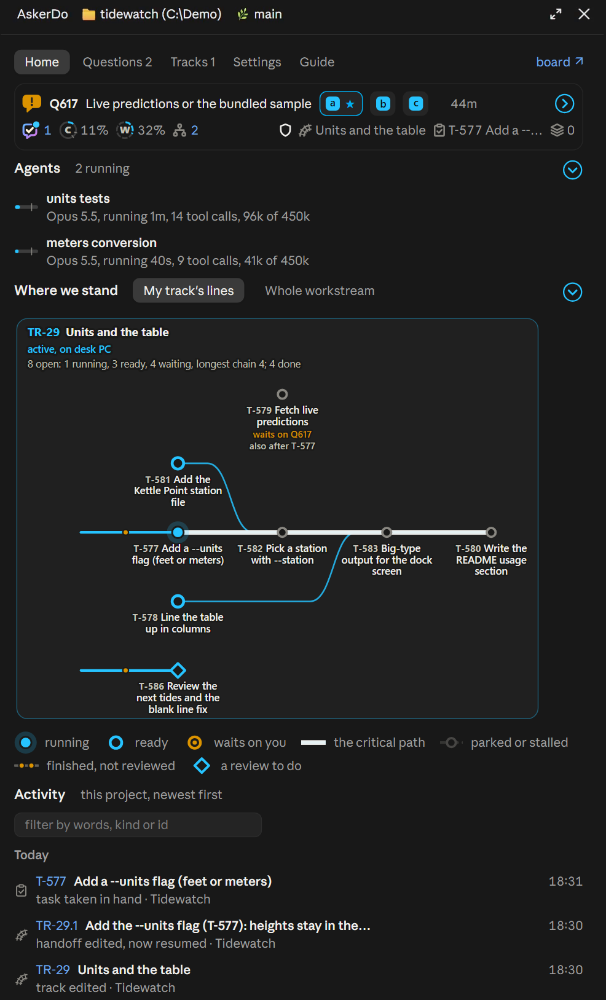</td>
<td valign="top">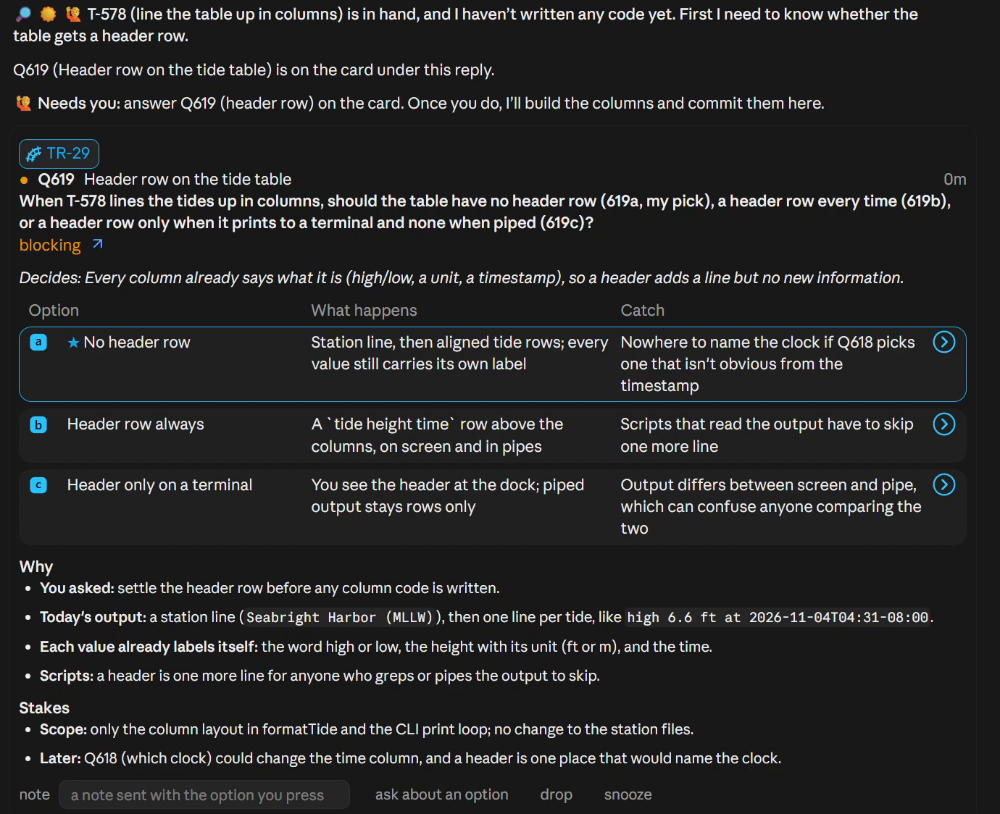<br><br>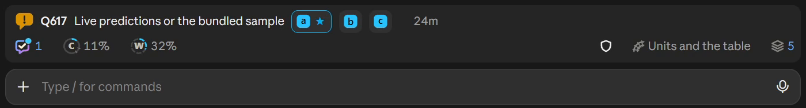</td>
</tr>
<tr>
<td valign="top"><b>The AskerDo pane:</b> where your track stands, drawn as a graph, with the agents running and the project's activity.</td>
<td valign="top"><b>Replies and question cards:</b> every reply opens with its bottom line and ends with what waits on you; a question comes as a card you answer with one press. <b>The band</b> above the prompt keeps open questions and the session's status in reach.</td>
</tr>
</table>

AskerDo runs inside the Claude desktop app and Claude Code. Its board runs on your one PC, or on a server that every PC you use shares.

## A mod, not only a plugin

A plugin adds skills, hooks and an output style. A mod changes the app itself, and AskerDo is both: most of what you see of it is drawn into the Claude desktop app's own window. Claude mods are new and there are few of them, and few reach this far into the desktop app:

- **The Needs you band** above the prompt box: each open question with its answer chips, the calls only you can close (a look, a review due, an override), answers waiting, and a row naming what to fix when AskerDo on this PC needs it.
- **The status row** on the band's last line: the context and usage rings, the agents running and their depth, the agent guard, the track and task this session holds, and the shelf.
- **Question cards** under the reply that asked, answered with one press, with the reply's Needs you footer drawn under the last card.
- **The AskerDo pane** beside the conversation, with **Home**, **Questions**, **Tracks**, **Settings** and **Guide** tabs.
- **The station map** on Home: the held track drawn as stations with what waits on what, the finished work no review has read yet, and each review with what it covered.
- **Links everywhere**: every track, task, question and decision name the pane and the band's hover cards draw opens its page on the board.
- **The `/askerdo` command**, which answers in the app itself, most of it without starting a model turn.

Claude Code in a terminal gets the same band, status row and `/askerdo` command, drawn in text. The reply shape, the skills and the board also work where the mod does not run ([Install](#install) says which releases carry it).

## What it looks like

**Replies you can scan.** Every reply opens with three anchor emoji and a bold bottom line (what happened, how it is going, whether you are needed) and closes with a footer that says what waits on you. The plugin writes this contract from your options and installs it as an output style.

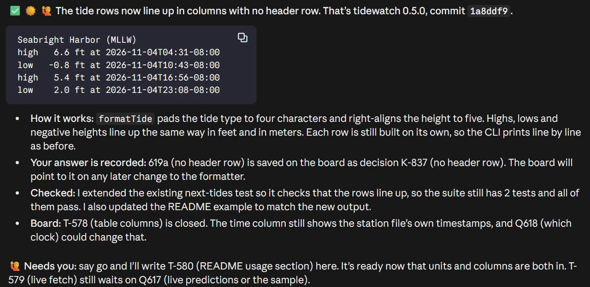

**Questions on a card.** A question arrives as a card under the reply that asked it: the ask, the fact that decides it, and each option with what happens and its catch, the session's pick starred. Press an option, or type its token (`619a`), and the answer reaches the session even mid-task. The band above the prompt keeps every open question in reach with its answer chips.

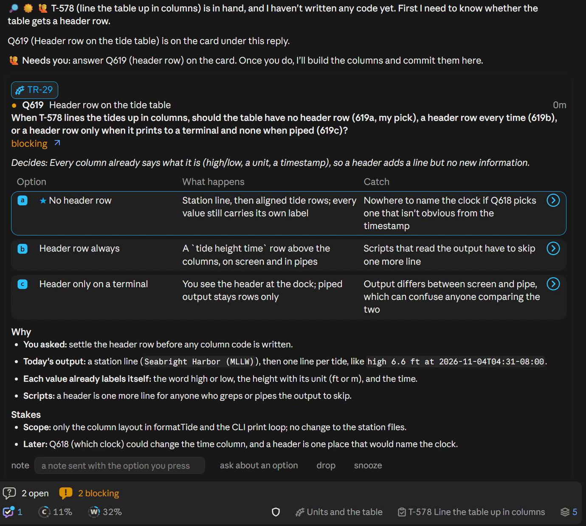

**One board for every PC.** Questions and work live on the board, not in one session's memory, so a question outlives the session that asked it and any session or PC can answer it. The board's web pages draw each workstream as a map of its tracks, what waits on what, and what needs you.

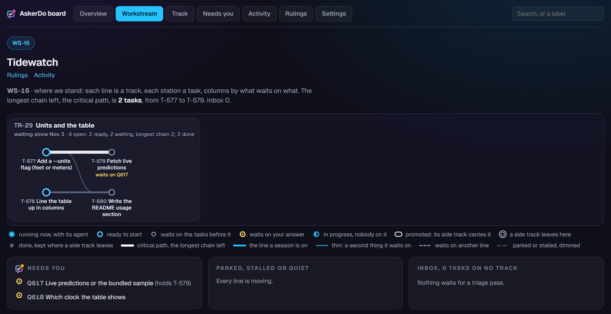

The AskerDo mark on the status row shows what waits elsewhere; hover it for the list.

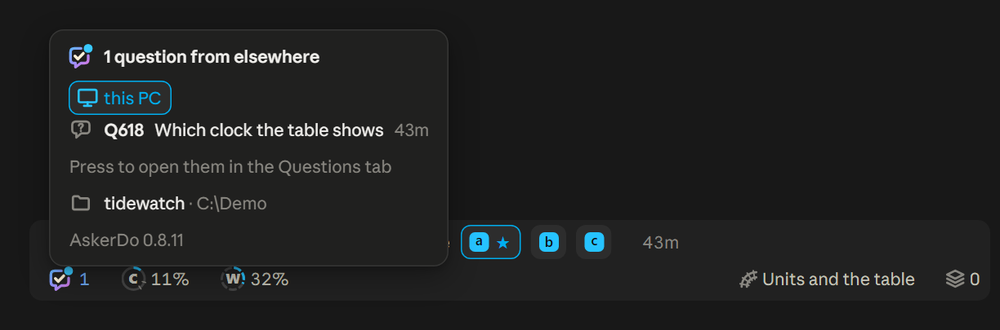

**Tracks and handoffs.** Work is laid out as tracks of tasks with what each depends on. A session holds one track, and when its context runs deep it writes a handoff on the board; the next session resumes from it with one command and starts from the kickoff: where it stands, what is ready, what is in flight.

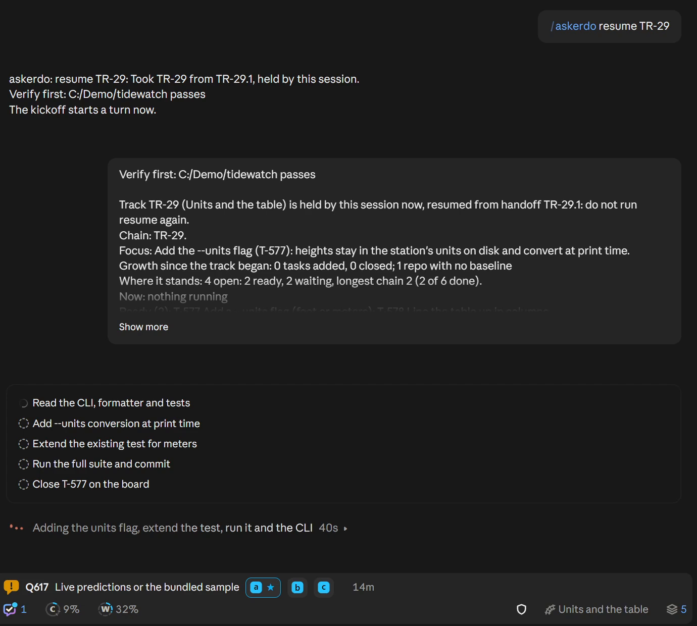

The track on the status row opens its card: progress, what is ready next, the longest chain, the question holding it and the last handoff.

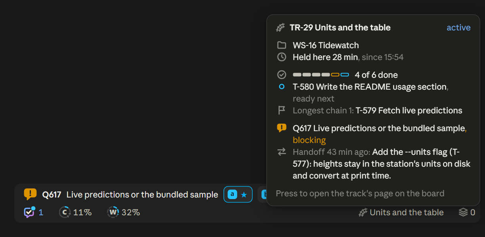

**Reviews on the board.** Each commit is linked to the task it finished, and a review task records the code tasks it read. Once a track's unreviewed code tasks reach the review size (5 by default), the band and the Tracks tab say a review is due. The station map draws unreviewed work as amber beads on the track and each review as a diamond holding what it covered. At the full review depth, a review reopens when work it read changes, and a track finishes only once a review has read its code.

**Tray popups.** On Windows, a tray icon shows whether anything is blocking and pops up a card when a question arrives, so a question reaches you while the app is in the background.

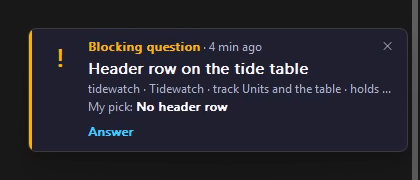

**The AskerDo pane.** A pane beside the conversation has Home, Questions, Tracks, Settings and Guide tabs; the Guide tab lists these docs, each opening on GitHub at the version you run. `/askerdo` drives it all.


Home holds a copy of the band, the agents this session has running, where the held track stands drawn as a graph of its tasks, and the project's activity, newest first.

## In motion

A question asked on a card, answered with one press: the confirm strip, the band row clearing, and the session carrying on.

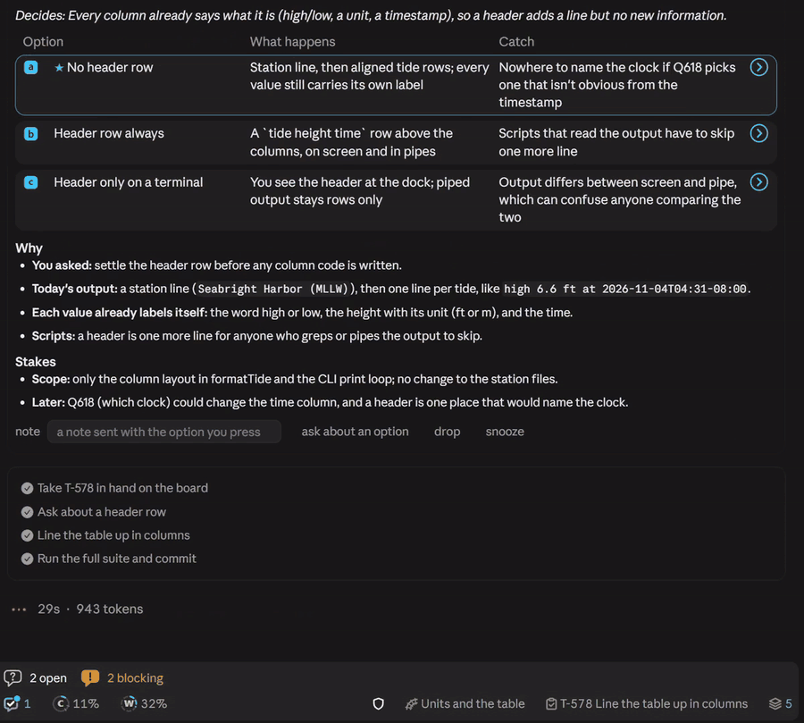

## Before and after

The same request in two sessions: plan a `--units` flag for a small command line tool.

|Claude's built-in Concise output style|AskerDo|
|-|-|
|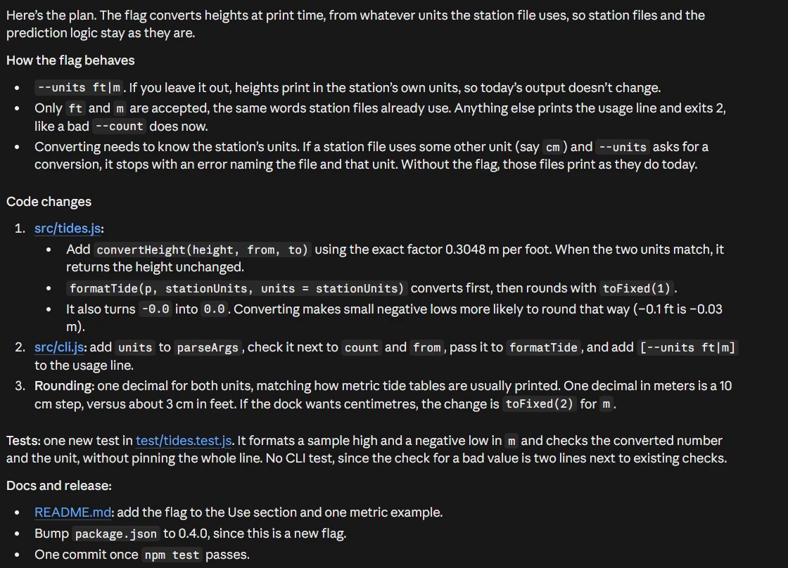|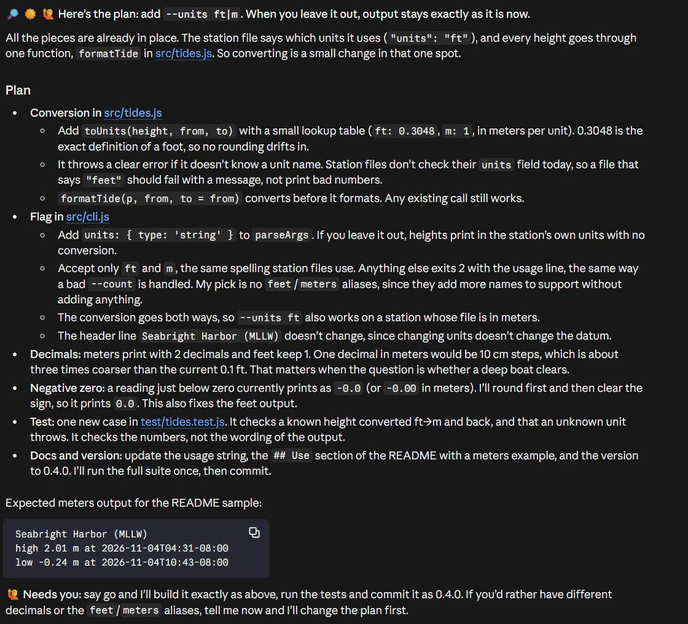|

Configure sets up the board with you, so everything above is there from the first session. Where a board cannot run (a Node older than 24 on a PC that would host it) or you decline one, AskerDo falls back to text mode: the reply contract, with open questions kept as files in each project ([what text mode lacks](docs/guide/getting-started.md#text-mode-when-there-is-no-board)). The [reply rules page](docs/guide/reply-rules.md) explains every rule of the reply shape with an example.

## Install

Two routes, both through the same install and the same configure skill:

|You use AskerDo on|Configure's board answer|What you get|
|-|-|-|
|One PC|**A board on this PC** (the default)|The board runs beside Claude Code on this PC, answers only this PC and copies itself daily. It moves onto a server later with one command.|
|Several PCs, or you want the board always on|**A Docker board**, on this PC or another machine|Configure walks the Docker setup: on this PC it builds and starts the container itself; for another machine it writes a folder you copy there and start with one command. Every PC joins it with a code.|

The marketplace add clones the public GitHub repository `ToxMox/askerdo`. From a terminal:

```sh
claude plugin marketplace add ToxMox/askerdo
claude plugin install askerdo@askerdo
```

Then, in any Claude Code session:

```text
/askerdo:configure
```

A later release reaches a PC with `claude plugin update askerdo@askerdo` and a new session, or on its own once the Claude app's auto-update for AskerDo is on, which configure offers ([Updating](docs/guide/getting-started.md#updating)). Never remove the marketplace to update: a remove uninstalls the plugin with it.

Configure asks for your options, installs the output style, then asks which board this PC uses: a board on this PC, a Docker board, or one you already have, and offers once to turn on the Claude app's auto-update for AskerDo and, on a board, to pick how closely the board tracks reviews. It runs every step itself, with no file to edit by hand. The style loads at session start, so the new shape shows in your next session. [Getting started](docs/guide/getting-started.md) walks it through.

Requires Node.js on the plain `PATH` (any recent LTS: the hooks, skills and CLI run with `node`; a board on this PC needs Node 24 there, while a Docker board brings its own) and Claude Code 2.0.37 or newer, the release that added the `keep-coding-instructions` field this plugin's output style sets. On 2.1.91 and newer the style is picked by the `outputStyle` setting, which configure writes for you. The band above the prompt, the AskerDo pane and the `/askerdo` command come from the plugin's mod, measured on Claude Code 2.1.299 and later; an older release was not measured, so expect only the output style, the skills and the hooks there.

## Read next

|Page|For|
|-|-|
|[Getting started](docs/guide/getting-started.md)|Install, configure, pick a board, your first question|
|[Daily use](docs/guide/daily-use.md)|The band, the status line, the pane and every `/askerdo` command|
|[Concepts](docs/guide/concepts.md)|Questions, workstreams, tracks, handoffs, review coverage, profiles, knowledge, decisions, procedures|
|[Set up a board](docs/guide/board-setup.md)|A board on this PC, with backups and restore, or a board in Docker; moving between them|
|[Add a PC](docs/guide/add-a-pc.md)|Join another PC with a code; what each platform gets|
|[Onboard a project](docs/guide/onboarding.md)|Move a project's old notes onto the board|
|[Settings and rules](docs/guide/settings-and-rules.md)|Reply settings, profiles and rule lines|
|[CLI reference](docs/guide/cli.md)|Every `askerdo` verb|
|[Troubleshooting](docs/guide/troubleshooting.md)|`askerdo status`, the board offline, notifications, a stuck track, the logs|
|[Architecture](docs/guide/architecture.md)|The parts and how a question travels|

The [docs index](docs/README.md) also lists the reference Claude reads and the build history.

## Changing a setting

Every option lives in the Settings tab of the AskerDo pane (`/askerdo pane`, then Settings): each setting with what it does, an example, where its value comes from, and a chip to choose where a board user sets it. On a PC on a board, in a terminal, `node ~/.claude/askerdo/cli.mjs settings` lists the same rows and `settings set <key> <value>` changes one (`settings unset <key>` puts it back): `contract.<option>` for a contract option, `on` or `off` for a toggle, a JSON list for `contract.custom`. In text mode there is no launcher, so use the Settings tab (where `queue` switches between `text` and `off`), and a write lands in `config.json`; for a board user a contract option lands on their profile on the board first, and a refused or unreachable board writes nothing. Each write regenerates the output style on the spot; it never touches `settings.json`, which stays the configure skill's job. A refused value says why in the setting's own words and writes nothing.

## The four skills

|Skill|What it does|
|-|-|
|`/askerdo:configure`|Set up the contract by interview, or from options pasted from another PC: eleven toggles, your own custom rules (without a board), dialog policy and the mod's command alias; writes each through `askerdo settings set`, installs, and puts this PC on a board: a board on this PC, a guided Docker board, or one you already have (text mode when you decline); offers the Claude app's auto-update for AskerDo once per PC, and on a board the review coverage depth|
|`/askerdo:chat-preferences`|Print the claude.ai personal-preferences text for pasting into chat settings|
|`/askerdo:measure`|Re-run the display-capability test cards and report deltas against the shipped docs|
|`/askerdo:onboard`|Move one project's old handoff files, TODO lists, decision logs, CLAUDE.md rules and Claude memory onto the board, after a read-only survey, a review page you mark and a rehearsal on a scratch board; a manifest undoes the import|

## What it writes, and where

|Path|Content|
|-|-|
|`~/.claude/output-styles/askerdo.md`|the contract, as a generated output style ending with its desktop and terminal sections (where the mod runs it adds the session's one to the prompt); rewritten whole on every change|
|`~/.claude/settings.json`|one key, `"outputStyle": "askerdo"`; every other setting is preserved. On a yes to the auto-update offer, also `autoUpdate` on the `askerdo` entry under `extraKnownMarketplaces` when that entry is there|
|`~/.claude/plugins/known_marketplaces.json`|on a yes to the auto-update offer, `"autoUpdate": true` on the `askerdo` entry, the switch `/plugin` shows under Marketplaces; every other key is preserved|
|`~/.claude/settings.json.bak` (then `.bak1`, ...)|copy taken before that key is written, which normally happens once|
|`<data>/config.json`|your saved options, custom rules included|
|`.claude/questions/<session-id>/` (in each project)|the session's question queue in text queue mode: one markdown file per registered question plus its index. Untracked working state the model never stages; add `.claude/questions/` to your repo's ignore rules if the git-status noise bothers you|
|`~/.claude/askerdo/`|a board PC's folder, outside every repo: the CLI launcher, the local server's state, the answer inboxes and the log ([what each holds](docs/guide/architecture.md#files-on-disk))|
|`~/.claude/askerdo/board-host/`|on a PC that hosts its board: the board's database, its daily copies (unless the `boardBackups` setting names another folder), `host.json` and `board.log` ([a board on this PC](docs/guide/board-setup.md#a-board-on-this-pc))|
|`<data>/handoffs/`, `<data>/kept/`|the loose-file lists of each handoff written on this PC and the dispositions kept per repo; they stay on this PC, and the board holds only each repo's pass-or-fail summary|
|`<data>/queued-answers.json`|answers you queued on a question card until **Send**, by session; they stay on this PC|
|`<data>/claude-chat-preferences.md`|the claude.ai text as last exported|
|`<data>/sync.log`|one line per state change, warning, or error; a run that changes nothing logs nothing|
|`<data>/commit-links.log`|a line for each time a handoff, a resume or `coverage --scan` could not link the commits whose messages name a task|
|`<data>/last-sync`|zero-byte stamp, touched by every flagless sync run, that collapses the harness's duplicate hook spawns to one set of messages|

`<data>` is this PC's folder, `~/.claude/askerdo/pc/`. It sits outside the plugin's own data directory and outside the versioned plugin cache, like the rest of `~/.claude/askerdo/`, so a plugin update, an uninstall or a marketplace remove never deletes your options, the launcher path or the inboxes; the records live on the board server. Where this PC's files are still in the plugin data directory (`~/.claude/plugins/data/askerdo-askerdo/` or a sibling holding `config.json`), they are read there until the next session start copies them into `pc/`, which leaves the old folder as it was.

## claude.ai chat preferences

The chat apps read nothing from disk, so the plugin also generates a companion text for claude.ai Settings, personal preferences. It is deliberately an ethos rather than a rulebook, because in chat the likely failure is over-formatting. `/askerdo:chat-preferences` prints it ready to paste, and the session-start sync nudges you when your saved config has drifted from what was last pasted.

## Uninstall

`claude plugin uninstall askerdo@askerdo`, then delete `~/.claude/output-styles/askerdo.md` and remove the `"outputStyle"` line from `~/.claude/settings.json`; the plugin never edits your settings on the way out, and Claude Code falls back to its default style once that line is gone. An uninstall never touches `~/.claude/askerdo/`: your saved options and board join in `pc/` stay for a later reinstall, and a board on this PC under `board-host/` stays too. Your questions are yours, so delete that directory by hand if you want no trace.

## Development

```sh
node scripts/run-tests.mjs       # the tests: golden fixtures, sandboxed sync, the contract save and the rest
node scripts/build.mjs           # write docs/guide/reply-rules.md, the generated part of docs/guide/cli.md and server/version.json
node scripts/build.mjs --check   # verify those are current
node hooks/board-server.mjs      # run this PC's local server, print its URL
node server/cli.mjs serve --db F # run a board server on a database file (the container runs this)
node scripts/build-viewer.mjs    # dev-side: rebuild the vendored viewer assets under assets/ from pinned versions
node scripts/build-tray.mjs      # dev-side: rebuild assets/askerdo-tray.exe from tray/ and its licence notices
claude plugin validate .         # manifest sanity
```

The golden fixture bodies were produced by the original configurator page's generator, so the tests prove the extraction stayed byte-faithful; they pin the whole output-style file, frontmatter included. The rules page is written from the builder's own output, so page and plugin can never drift. There is no CI: the release procedure runs the tests, the build check, manifest validation and the plugin tests locally. The `assets/` directory is committed prebuilt so the runtime stays zero-dependency ([what it holds](docs/guide/architecture.md#working-on-the-code)).

## License

MIT
