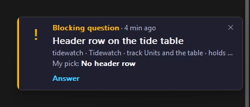

# Add a PC

Put another PC on a board that already runs, so its sessions share your questions, tracks and settings. A PC already on the board mints a one-time join code, and the new PC trades it for its own device token.

This is configure's **Join a board I have** answer ([Pick a board](getting-started.md#3-pick-a-board)). No board yet? Configure sets one up on its other two answers, and [Set up a board](board-setup.md) covers each, the first PC included. When a step below fails, see [Troubleshooting](troubleshooting.md).

## Before you start

|On the new PC|Why|
|-|-|
|Claude Code, signed in|The plugin, its hooks, skills and mod load in its sessions.|
|git, and a network path to GitHub|The plugin marketplace is a git clone of the public AskerDo repository, `ToxMox/askerdo`.|
|Node on the plain `PATH` (any recent LTS)|Hooks and the CLI run with `node`; only a PC that hosts a board needs Node 24. On Windows the local server is started by a logon task, which sees only the system `PATH`: a Node that only a shell profile or a version manager adds never reaches it. `where.exe node` should name the installer's `node.exe`.|
|The board's address|`http://<server>:17480`, or whatever the board's admin published. `curl -s http://<server>:17480/health` from the new PC should answer `{"ok":true,...}`.|

## Join

1. Install the plugin on the new PC (the install lines are in the [README](../../README.md)) and start a new session, so its hooks and skills load.

2. Run `/askerdo:configure` and answer **Join a board I have**. It asks for the board address and a join code.

3. Only now mint the code, on a PC already on the board, since it expires ten minutes after it is made:

   ```sh
   node ~/.claude/askerdo/cli.mjs join-code
   ```

   On Windows the tray's **Add a PC** opens a page that mints one too. Both print the board address and a code like `ABCD-EFGH-JKMN`. A [board on this PC](board-setup.md#a-board-on-this-pc) answers only this PC, so both refuse there and name `askerdo board move`: [move it to a server](board-setup.md#move-to-a-server) first.

4. Give configure the address and the code. Under the hood it runs:

   ```sh
   node <plugin>/bin/askerdo.mjs join http://<server>:17480 ABCD-EFGH-JKMN
   ```

   The join saves the board address, this PC's own token and the hub queue in the PC's AskerDo config (`config.json` in `~/.claude/askerdo/pc/`, where no plugin update or remove reaches it), then copies your reply options from your profile on the board when the board holds them, so the new PC answers in the same shape as the others at once. A board that holds none yet (its first PC joined without `--seed` and set none since) makes the join say `the board holds no options yet`; configure's interview then sets each option on the board, and every PC takes them at its next session start. It prints the name the PC joined as and never the token, and ends with when this PC picks the board up: at once when its local server is running (it rereads the config every second), else at the next session start. For a board on another machine it adds that this PC reads and writes that board through its local server.

5. Configure runs the session-start sync once more, which writes the launcher `~/.claude/askerdo/cli.mjs` and starts the local server now (and, on Windows, the tray). Check the PC reaches the board:

   ```sh
   node ~/.claude/askerdo/cli.mjs board
   node ~/.claude/askerdo/cli.mjs list
   ```

6. Map your projects, so a link naming a folder on another PC opens the same project here. Each session start maps the project it opens in; a scan maps the rest now, looking up to three folders down for git checkouts (it skips `node_modules`, hidden folders and links):

   ```sh
   node ~/.claude/askerdo/cli.mjs projects scan <folder holding your repos>
   node ~/.claude/askerdo/cli.mjs projects
   ```

### The code's rules

|Rule|Detail|
|-|-|
|Once, for ten minutes|A code works one time and expires ten minutes after it is minted. Minting another on the same PC replaces it.|
|The PC's name|The new PC joins under its host name, cleaned to letters, digits, dots, dashes and underscores. `--device <name>` on the join picks another.|
|No name taken|A code minted without `--device` refuses a name already on the board, so a join can never cut off a PC that is on it. The refusal does not spend the code: join again with another name.|
|Rejoin|To put back a PC that is already on the board (reinstalled, or its token lost), mint the code with `join-code --device <its name>`, then on that PC run `node ~/.claude/askerdo/cli.mjs join http://<server>:17480 <code>`, which replaces the device's token on the board and in `config.json`. Configure offers a join only while `config.json` holds no token, so a PC that still holds one rejoins with this line; a reinstalled PC with no saved config joins through configure as above.|
|Wrong codes|After five wrong codes the board refuses joins for a minute. A freshly minted code starts the count again.|

## What the PC runs

**The local server.** Each PC on a board runs one small server of its own (`hooks/board-server.mjs`) on `askerdo.localhost` at a port it picks once and keeps (`17435` unless something else holds it). It holds one event stream to the board and a cache of the working set, serves the CLI, the mod and the tray, writes each session's answer inbox from the stream, and raises alerts. Every write goes straight to the board; when the board cannot be reached, reads come from the cache and say so, and writes fail plainly with nothing queued.

On Windows it is started by a scheduled task named `AskerDo board`, registered for your user at logon, so the server is never a child of a Claude session and outlives it. On macOS and Linux each session start starts it detached, so it outlives the session too. On every platform each session start checks it answers and starts or replaces it when the plugin was updated. Its files live in `~/.claude/askerdo/board/`.

On a PC that hosts its board ([A board on this PC](board-setup.md#a-board-on-this-pc)), the local server also runs the board as its child and starts it again when it exits.

**The tray (Windows).** `askerdo-tray.exe` ships with the plugin and the local server starts it. Its icon wears one of three faces: nothing waiting, questions waiting, or a question blocking work, drawn for a light or a dark taskbar. The tooltip counts the blocking questions. Right click opens a menu built from what the board holds at that moment:

|Menu line|What it does|
|-|-|
|Counts line|`3 blocking, 6 waiting`, or `nothing waiting`.|
|Blocking questions|Up to five, oldest first; each opens its card.|
|Waiting questions|Up to five, newest first; each opens its card.|
|Open board|The board's overview in your browser, signed in.|
|Activity|A window listing the board's activity, newest first.|
|Add a PC|A page on the local server that mints a join code.|
|Notification settings|Which alerts show, quiet hours, sounds, and a test button for the popup.|
|Pause notifications|For an hour, until tomorrow morning, or until you resume; the line reads `Paused until 15:40` while a pause holds.|
|Exit|Closes the tray until the local server next starts.|

Alerts draw as cards in the tray's own popup by the tray corner: a blocking question, a new open question, a question closed or woken, a task completed or dropped, a plan or workstream closed, and one summary card when many arrive at once. Each kind can be switched off on the Notification settings page. The tray is also the one program that opens the files and folders a record links. A Start Menu entry named AskerDo opens the board.



## What each platform gets

Windows is where AskerDo is built and measured. The code has a Windows-only path for the parts below marked so; nothing on macOS or Linux has been run, so those columns say what the code does, not what was seen.

|Part|Windows|macOS|Linux|
|-|-|-|-|
|Plugin, reply contract, `/askerdo:configure`, the join|Yes|Same Node code, no platform branch (unmeasured)|Same Node code, no platform branch (unmeasured)|
|CLI (`node ~/.claude/askerdo/cli.mjs`)|Yes, through the local server|Runs each command straight against the board when no local server answers (unmeasured)|As macOS (unmeasured)|
|Local server started for you|Yes: the `AskerDo board` scheduled task, at logon and at each session start|Yes: each session start starts it detached when it does not answer, and replaces it after a plugin update; nothing starts it at login ([below](#between-sessions-on-macos-or-linux)); unmeasured|As macOS|
|A board on this PC|Yes: started and kept running by the local server, which the scheduled task starts|Started and kept running by the local server the session start starts, so it comes up with the first session after a restart (unmeasured)|As macOS|
|Answers reaching a session at its next prompt|Yes, where the mod runs|Yes, through the local server (unmeasured)|As macOS|
|The mod's band, pane and `/askerdo` commands|Yes|Yes, through the local server (unmeasured)|As macOS|
|Tray, alert popups, notification settings|Yes|None: alerts are logged and dropped (`notify: unavailable on this platform`)|None, as macOS|
|Opening a record's files and folders|Yes, through the tray|None: `the native opener is wired on Windows alone`|None, as macOS|
|`login`, opening the board in a browser|Yes|Opens with `open` (unmeasured)|Opens with `xdg-open` (unmeasured)|

### Between sessions on macOS or Linux

This is read from the code and has not been run. Nothing starts the local server at login, so after a restart it is down until the first session starts it, and with it a board this PC hosts. To bring both up without a session:

```sh
node ~/.claude/askerdo/cli.mjs board
```

`board` starts the local server detached when it does not answer, the same as a session start, and prints `board started at http://askerdo.localhost:<port>/...`.

## Take a PC off the board

On the board's server:

```sh
docker exec askerdo node /app/server/cli.mjs token revoke <device>
```

The PC's token, browser sign-ins and any live join code it minted stop working at once. `token list` shows every device. On the PC itself, Windows keeps the scheduled task until you remove it:

```sh
schtasks /delete /tn "AskerDo board" /f
```
