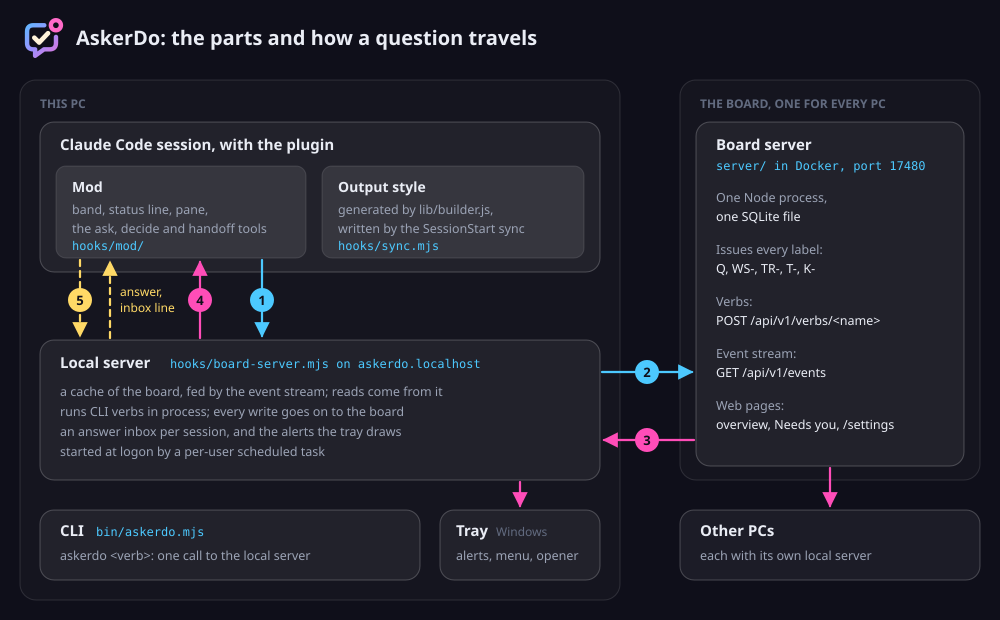

# Architecture

AskerDo is a Claude Code plugin with three running parts beside it: a local server on each PC, one board server every PC shares, and a tray on Windows. This page names each part, where its code lives, and how a question travels from a session to the board and back to the band.

The picture draws the board in Docker on its own host. On a PC that hosts the board, the local server runs the same board server as its child on 127.0.0.1, and a question takes the same five steps.

## The parts

|Part|Code|What it does|
|-|-|-|
|Plugin|`.claude-plugin/`, `hooks/hooks.json`, `skills/`|What `claude plugin install` brings in: a SessionStart hook (`hooks/sync.mjs`), a PreToolUse hook on AskUserQuestion (`hooks/dialog-policy.mjs`), the mod module and the four skills|
|Contract generator|`lib/builder.js`|The one source of the reply contract's text. Pure: no imports, no file system, no environment. The sync writes its output to `~/.claude/output-styles/askerdo.md`; `scripts/build.mjs` writes the [reply rules page](reply-rules.md) from it; golden fixtures in `test/` pin its output byte for byte|
|Mod|`hooks/mod/` (`index.ts`, `band.tsx`, `status.tsx`, `home.tsx`, `questions.tsx`, `pane.tsx`, `settings.tsx`), logic in `lib/mod-core.mjs`|Runs inside Claude Code, in the desktop app and the terminal. Draws the band above the prompt, the status line and the AskerDo pane; registers `/askerdo`; gives the model its tools (`ask`, `decide`, `note`, `task_update`, `handoff_write`, `handoff_update`, `depth`, `override_request`); puts the rules in force on each prompt and each Agent dispatch; hands answers to the model|
|CLI|`bin/askerdo.mjs`, verbs in `lib/cli-commands.mjs`|`askerdo <verb>`: one keep-alive call to this PC's local server, which runs the verb in process. With no local server answering, the launcher runs the same module itself. The sync keeps a stable launcher at `~/.claude/askerdo/cli.mjs`|
|Local server|`hooks/board-server.mjs`, `lib/local-board.mjs`, `lib/local-route.mjs`|One per PC, bound to loopback at `http://askerdo.localhost:<port>/<secret>/`. Holds a cache of the board fed by one event stream, serves the mod, the CLI and the tray, writes each session's answer inbox under `~/.claude/askerdo/inbox/`, opens the files a record lists, and serves the notifications and Add a PC pages. On a PC that hosts the board, it also runs the board server as a watched child (`lib/board-host.mjs`): it starts it, starts it again when it exits, and stops it when it stops|
|Board server|`server/` (`api.mjs`, `db.mjs`, `verbs/`, `web/`, `migrations/`), run by `server/cli.mjs serve`|One Node process and one SQLite file holding every record. It alone issues labels (`Q`, `WS-`, `TR-`, `T-`, `K-`). Verbs arrive as `POST /api/v1/verbs/<name>` with a device token; every commit's activity rows go out at once on `GET /api/v1/events`; its web pages show the board in a browser. Runs in Docker, its image built from the plugin folder (`server/Dockerfile`, `compose.yaml`, port 17480), on a host with Node 24, or on a PC that hosts it, run by that PC's local server|
|Tray|`tray/` (Rust), built to `assets/askerdo-tray.exe`|Windows only. The tray icon and its faces, the menu, alert cards in a popup by the tray corner, and the one opener for files and folders a record links. A per-user scheduled task runs it with `--serve` at logon, which starts the local server; the local server then runs the tray as its client|

`/askerdo:configure` puts a PC on a board: one on this PC, a Docker board, or one it already has ([Pick a board](getting-started.md#3-pick-a-board)). In text mode, the fallback for a PC with no board, these run: the plugin's hooks and skills, the contract the generator writes, the mod, and the CLI's no-board verbs (`settings` and its writes, which the pane's Settings tab calls), with questions kept in the session (`L1`, answered `L1a`) or as files under `.claude/questions/`. The local server, the board server and the tray come in when a PC hosts or joins a board ([Set up a board](board-setup.md), [Add a PC](add-a-pc.md)).

## How a question travels

The numbers match the picture.

1. **The model asks.** It calls the mod's `ask` tool. The mod checks the shape (one plain question, lettered options, a pick) and runs `askerdo register` with the payload. A session that has not used AskerDo yet keeps the question under a local label instead, and files it on the board once it engages.
2. **The local server passes it to the board.** The mod posts the CLI call straight to the local server's route; the server runs the verb in process and sends the write on as `POST /api/v1/verbs/register`. The board commits the question, gives it its label (`Q-n`) and writes an activity row.
3. **The board tells every PC.** The new row goes out on the event stream at once. Each PC's local server reads it, by sequence number, into its cache. A PC that was offline catches up from its saved cursor when it reconnects.
4. **The band and the tray show it.** The band holds a long poll on the local server, which answers the moment a change lands, so every session in that project redraws the question with its answer chips. On Windows the tray draws an alert card.
5. **The answer comes back.** You press a chip, type `/askerdo 106b`, or answer from another session or PC. The answer takes the same road to the board. When its row returns on the event stream, the asking PC's local server appends a line to that session's inbox, keyed by its sequence so a replay never tells it twice. The mod hands the line to the model at the next prompt or, mid-turn, at the next step.

When the board cannot be reached, reads come from the local cache with a note saying so, and writes fail plainly: nothing is queued to replay later.

## Platforms

The local server's scheduled task and the tray are Windows only in the code (`lib/board-task.mjs`, `lib/tray.mjs`). On macOS and Linux the session start and `askerdo board` start the local server as a detached process (`startLocalServer` in `lib/board-host.mjs`), which runs a board this PC hosts the same way; with no local server answering, the CLI runs each verb in place. Neither path has a measured run. [Add a PC](add-a-pc.md) says what each platform gets.

## Files on disk

|Path|What it holds|
|-|-|
|`~/.claude/output-styles/askerdo.md`|The generated contract, rewritten whole by the sync|
|`<data>/config.json`|Saved options, the board address and this PC's token (`<data>` is the plugin data folder Claude Code names, usually `~/.claude/plugins/data/askerdo-askerdo/`)|
|`<data>/queued-answers.json`|Answers queued on a question card until Send, by session, so a restart keeps them; sessions untouched for 30 days drop out|
|`~/.claude/askerdo/`|A board PC's folder, outside every repo and the versioned plugin cache, so it survives updates (the records live on the board): the stable CLI launcher `cli.mjs`, which the sync re-points at each plugin update; the local server's state under `board/` (`local.json` naming its localhost route, the event stream's saved cursor, its timings, and `notify.json` with the notification and open-in settings, written with defaults on the first Windows start and never overwritten); each session's answer inbox under `inbox/`; and the fail-open log|
|`~/.claude/askerdo/board-host/`|A PC that hosts the board: the database `askerdo.db`, its daily copies in `backups/` (unless `boardBackups` names another folder), `host.json` (the board's port, kept for good), `running.json` (the board now running), `board.log` (its output), and the board's `timings.log` and `checks.log`. A restore keeps the files it replaced in `before-restore/<stamp>/`; a finished move renames `host.json` to `moved.json`, and its copy for the new board is `askerdo-move-<day>-<time>.db` in the copies folder; a `board here` after a move sets the moved database aside in `moved/<stamp>/`. On a PC with a Docker board, `last-docker-backup.json` holds the day of its last daily copy|
|`.claude/questions/<session-id>/`|Text mode only: one file per question in the project|

## Working on the code

- The nine places a new option touches, as exact steps: [docs/procedures/add-config-option.md](../procedures/add-config-option.md).
- Recurring operations (tests, release, a new option) as exact steps: [docs/procedures/](../procedures/README.md).
- The tray's contract with the local server: [tray/README.md](../../tray/README.md).
- `assets/` is committed prebuilt, so the runtime installs nothing: the file viewer's client stack (markdown-it, DOMPurify, a highlight.js common build), the house stylesheet, the vendored Geist variable font with its OFL notice (`assets/geist-license.txt`), the marks, and the tray `assets/askerdo-tray.exe` with a notice naming every crate in its lock (`assets/licenses/askerdo-tray.txt`). `scripts/build-viewer.mjs` and `scripts/build-tray.mjs` alone touch npm and cargo, and neither runs in the release checks.
- The reference sessions read at run time, and what reads each file: [docs/README.md](../README.md).
