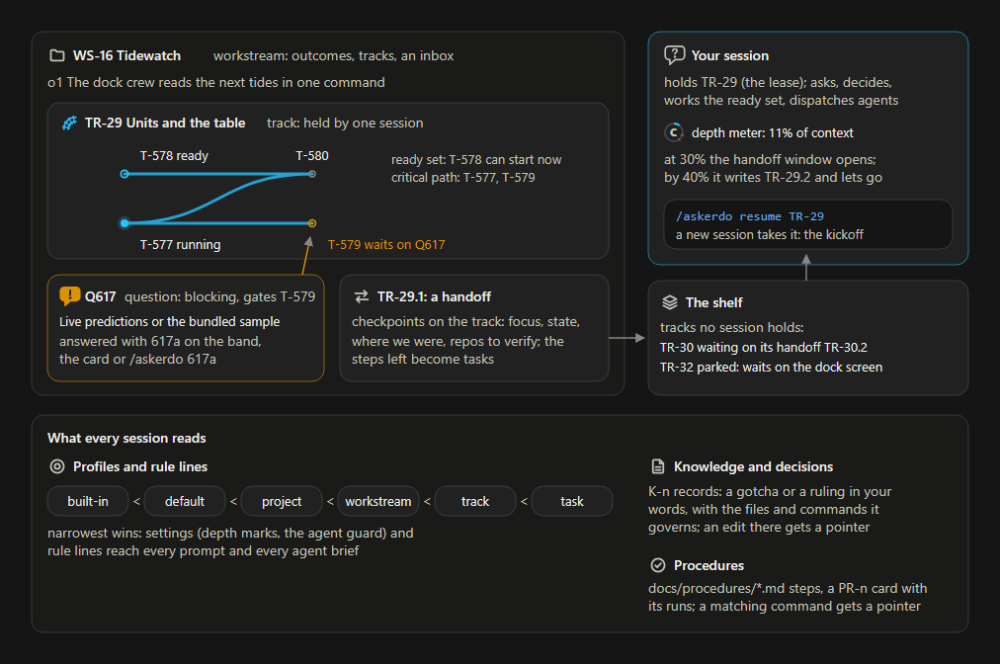
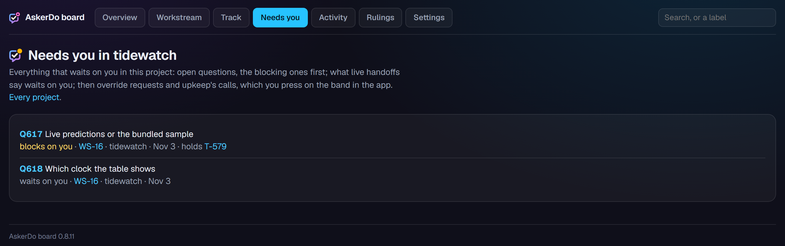
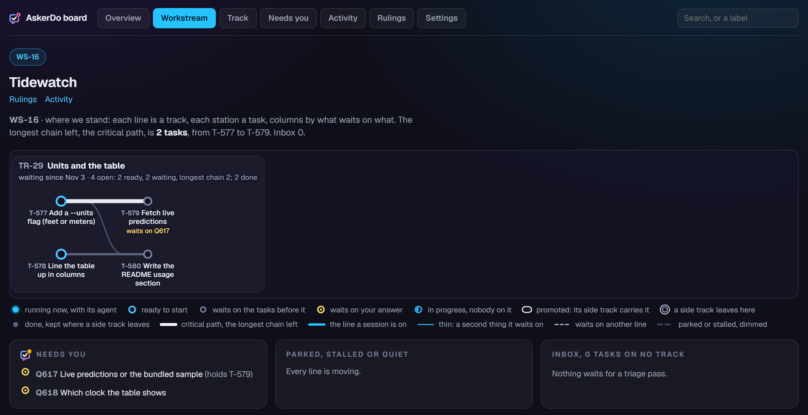
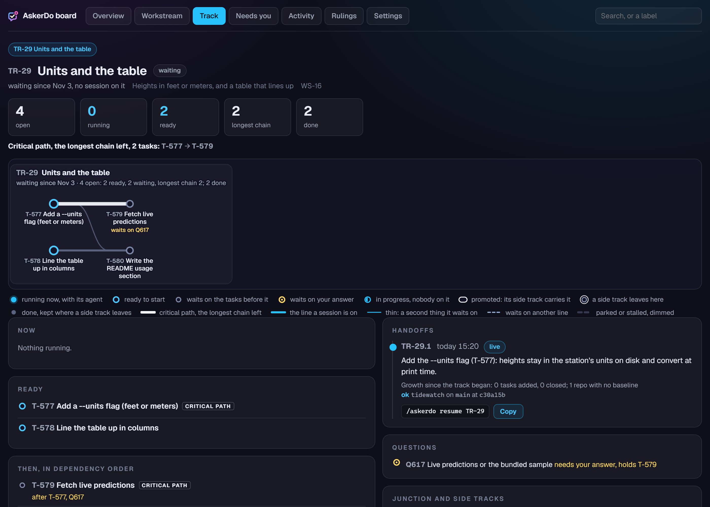
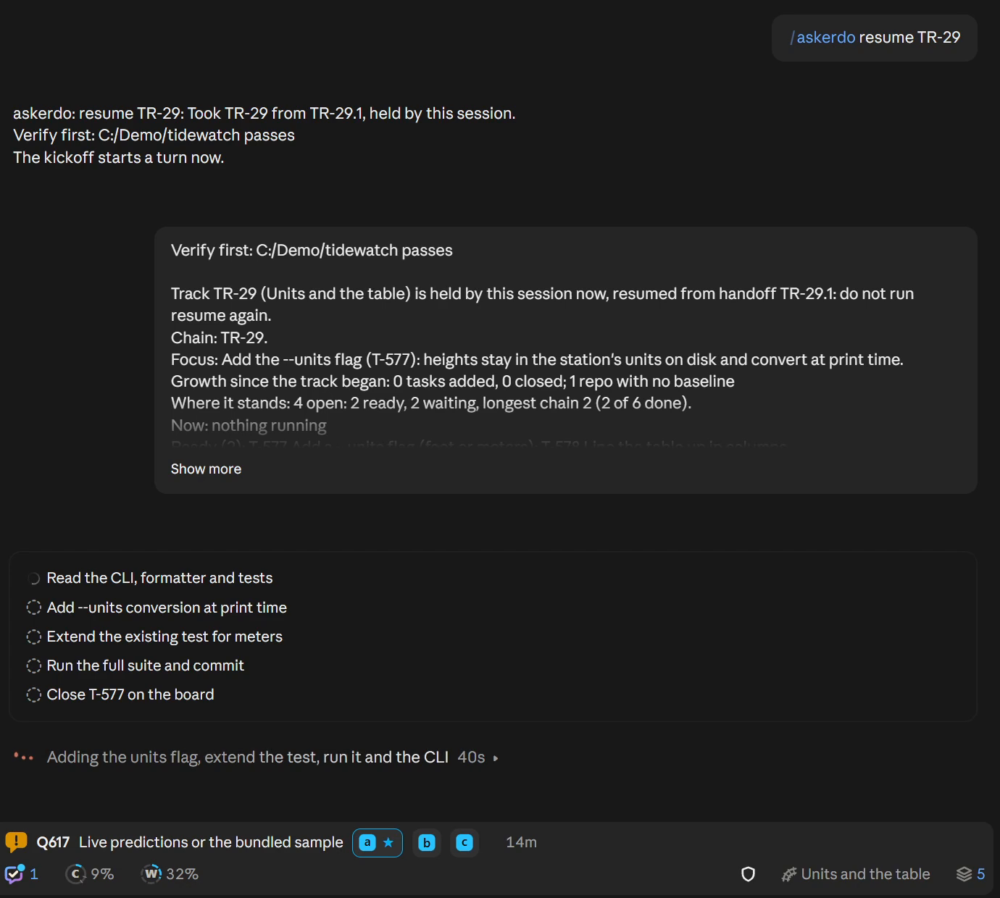
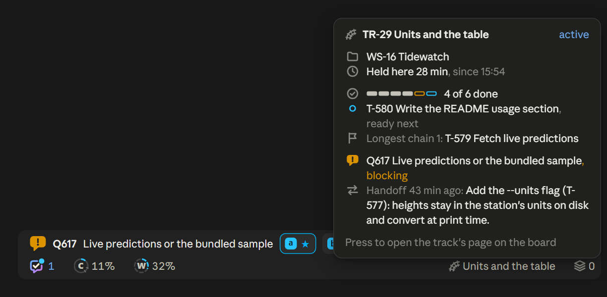

# Concepts

AskerDo keeps what Claude needs from you, and the work around it, on one board that every session and every PC reads. This page explains each part: what it is, why you would use it, and where you see it.

You can use AskerDo for questions alone. Workstreams, tracks and handoffs are there when work runs longer than one session.

## Questions

A question is a decision Claude needs from you, put as lettered options with one marked as its pick: `Q617 Live predictions or the bundled sample: the sample by default (a, my pick), live on every run (b), or live once a day (c)?`. The board numbers it, so it outlives the reply that asked it: you can answer it later, from another PC, or after the session has ended.

- **Blocking or not.** A blocking question stops some work until you answer; it shows in amber. One that is not blocking waits in blue while the session carries on with what it can.
- **Gates.** A question can gate tasks: a gated task is not ready until the question is answered (in the picture, T-579 waits on Q617).
- **Answering.** A token, the number and the letter: `617a`. Press a chip on the band or a tile on the card, type `/askerdo 617a`, or type `617a` in chat. [Daily use](daily-use.md#answering) lists every way.
- **Drop and snooze.** Drop a question that no longer matters, with a reason. Snooze one to a day or until something happens; it comes back then.
- **Local labels.** A session that has not used the board yet keeps its questions as `L1`, `L2`, answered `L1a`, and files them on the board once it does.

On screen: a row on the band, a card under the reply that asked, the Questions tab of the pane, the mark on the status line for questions from elsewhere, and the board page. The board's Needs you page lists every question open in the project, the blocking ones first:

The reference Claude reads for questions is [question-hub.md](../question-hub.md).

## Workstreams

A workstream (`WS-16 Tidewatch`) is a named body of work with outcomes in your own words (`o1 The dock crew reads the next tides in one command`). Tracks, tasks and questions belong to one. It can span several projects.

Each project also has an inbox workstream (`tidewatch: inbox`): a question asked outside any workstream lands there, so nothing is unfiled. A workstream's inbox, in turn, holds tasks not yet on a track, and the next session to take one of its tracks is asked to place them.

Work a session finds along the way is filed with its place: on its own track or another, before or after the step it belongs with, or unplaced with the reason it waits on no track. The handoff, the kickoff and the Tracks tab's **Found this arc** row list what an arc found and where each went, the unplaced first, so you see it at each gate.

Use a workstream when work has a goal bigger than one sitting. Small one-off work never needs one.

On the board, a workstream's page draws each track as a line of its tasks, with what needs you beside it:

## Tracks and the ready set

A track (`TR-29 Units and the table`) is one line of work inside a workstream: its tasks, ordered by "depends on" edges, and its handoffs. It is the unit a session works on.

- **One session per track.** A session holds one track at a time, and a track has one holder (its lease). Parallel work inside a track is that session's agents; parallel sessions mean parallel tracks.
- **States.** A track is **active** while a session holds it, **waiting** when no session holds it and it has a handoff to resume from, **new** before anyone has held it, and **parked** when set aside with a reason. **Stalled** marks one with open tasks and no activity for three days.
- **The ready set.** The board works out what can start now: open tasks whose dependencies are done and that no open question gates. A task that is not ready says what holds it (`after T-577`, `after Q617`).
- **The critical path.** The longest chain of open tasks through the track; its length is the least work left.
- **Side tracks.** A track can splinter: a side track starts from a task, the parent parks, and the chain shows where you are (`TR-33 under TR-29`).

Use tracks so the next session never has to work out what comes next from prose: the order lives in the edges, and the ready set follows from them.

On screen: the track name on the status line, the held track's card and graph on the pane's Home and Tracks tabs, and the track's page on the board:

## Handoffs and kickoffs

A handoff (`TR-29.1`, the track's first) is a checkpoint a session writes before it lets the track go: the one next action (its focus), the state, where the conversation with you stood, what waits on you, and each repo to check (branch, commit, loose files). The steps left go onto the track as tasks, never as a list in the prose.

Writing a handoff releases the lease, so the track goes to the shelf. When a session takes it with `/askerdo resume TR-29`, the board prints a kickoff: the track and its chain, the focus, what runs now, the ready set, the critical path, the rest of the tasks in order, what waits on you, answers since, and the handoff's state. That PC then checks the repos against the handoff and lists anything that moved.

Use a handoff to move work between sessions without losing the thread: a new session, a fresh context, another PC.

On screen: the held track's card names its last handoff, and so does the card the track's name on the status line shows on hover:

The pane's Tracks tab lists each track ready to pick up with its focus and age; `/askerdo handoff` asks the session to write one now, and `/askerdo park "reason"` a parked one. Asking in plain words in chat ("write your handoff now") works the same as `/askerdo handoff`, before the handoff window too.

## The shelf

The shelf is every track no session holds: waiting ones with their latest handoff, and parked ones with their reasons, oldest first.

On screen: the shelf count on the status line, the Ready to pick up and Parked sections of the Tracks tab, and `/askerdo resume` with nothing after it, which lists it.

## Review coverage

The board keeps which code each task finished with and which reviews read it, so a track shows what no review has looked at yet.

- **Commits link to tasks.** Every commit a session or its agents make is linked to its task: a task id in the commit message first, else the task the committing agent was dispatched for, else the task the session has in hand (the newest, marked as a guess, when it holds several). A commit no task owns counts as the project's own work. A handoff, a resume and `askerdo coverage --scan` also link commits made outside a session whose messages name a task; `askerdo commit move` relinks one by hand.
- **Code tasks.** A task is a code task once a linked commit changed counted source: tracked code and tests, never lockfiles, generated files, Markdown, plain text, anything under `docs/` or fixtures, or binaries. The `review.ignore` setting adds a project's own files.
- **Review tasks.** A task labelled `review`, or named "Review ...", is a review station. When it completes it covers every unreviewed code task on its track that finished before it started; `askerdo review covers` narrows the list. One made with `--review-scope project` reads every code task in the project since the last project-wide review, and the commits no task owns. A code task that gains a commit after its review is unreviewed again.
- **Due.** Once a track's unreviewed code tasks reach the review size (`review.tasks`, 5), a review is due. Where reviews go is the session's judgment; a built-in rule line asks for one after each wave of parallel work, where work touched code another lane also touched, and before anything that ships.
- **Depth.** `review.depth` is `light` by default: the due nudge, and nothing held. At `full`, a completed review reopens when work it read changes or a task before it finishes after it, so what waits on it waits again, and a track finishes only once a review has read its finished code (`track finish --waive "<reason>"` goes ahead and records why). At `off`, nothing is counted or shown.

On screen: a **review due** row on the band, whose press opens the Tracks tab at the track; a line in the kickoff and the handoff; on the Tracks tab, amber cells for unreviewed work in the track's progress bar, "N to review" beside the count, and a padlock on a finish that waits for a review; on Home's station map, unreviewed work as amber beads between the stations and each review as a diamond: outlined while to do, grey with "N covered" once done (press it for the list, each a link), amber with "N to review" when it reopened. `askerdo coverage TR-n` prints the same as text. The settings are in [Settings and rules](settings-and-rules.md#reviews).

## The depth meter

A session's context fills as it works. The depth meter watches it and has the session hand off at a clean point before quality drops.

- **The handoff window** (30 percent by default): the session starts looking for a point that cuts through nothing, finishes what is in flight, and hands off there.
- **The wrap line** (40 percent): the session starts nothing new and writes its handoff.

The session never picks the point on its own while you are in a conversation or a live look with it; it finishes with you first, or asks where to break. Agents have their own guard: a soft and a hard limit on their context (350k and 450k tokens by default), shown by the shield on the status line.

On screen: the **C** ring on the status line, sky blue, then amber in the window, then red past the wrap. Both lines are settings ([Settings and rules](settings-and-rules.md)). The reference Claude reads is [handoff-timing.md](../handoff-timing.md).

## Profiles and rule lines

A profile is a named set of settings and rule lines. It applies at a layer, and the narrowest layer that sets a value wins:

built-in < default < project < workstream < track < task

A session's settings come from the track it holds, else its project; its rules from the track, else its newest task in hand, else its project.

- **Settings**: the depth meter's lines, the agent guard's limits, the reply options, the test rules.
- **Rule lines**: one sentence each, with a short slug, sent to the session (`for session`), to its agents (`for agents`), or both. They reach every prompt and every agent brief.

Use a profile when one project, workstream or track needs different rules: a stricter test rule on a release track, a later handoff window on a long design session.

On screen: the Settings tab, where each row's chip names the layer that sets it. [Settings and rules](settings-and-rules.md) covers every setting and how to set it at each layer.

## Knowledge and decision records

A knowledge record (`K-n`) is a fact rather than work, kept so the next session does not relearn it:

- **A gotcha**: something that trips you up, and how to avoid it.
- **A decision**: a ruling you made, in your words, recorded the same turn you made it. It names what it governs: tasks, tracks, files, commands.

A record once used is never rewritten in place: it gets a dated amendment, or a new record supersedes it. Only an override, your **Allow** on its request, fixes a bug's text, withdraws a ruling you never made, or scrubs a secret.

Decisions act where they apply. When a session edits a file or runs a command a decision governs, a toast says "Decision K-12 applies" and the session is handed the ruling; nothing is blocked. A command counts by what it runs, the same way as a procedure's pointer (below). Each kickoff lists the decisions in force for its track.

On screen: the toast, the board's record pages, and override requests on the band with **Allow** and **Keep**.

## Procedures

A procedure is a recurring operation written down once as exact steps: a release, a migration, adding a setting. Each lives in the repo it operates on, as `docs/procedures/<name>.md`, and the board keeps a card for it (`PR-n`) with its runs and the commit it was last verified at.

- **Pointers.** A procedure names its trigger words, commands and files. When a session runs a matching command or edits a matching file, a toast names the procedure and the session is pointed at its steps; nothing is blocked. A pointer fires on the command a session runs, never on a search or read that names it (a `grep docker` or a `cat` of a script), nor on text a command only carries, such as a heredoc's body. A card can also be marked for the live install alone, so a run against a sandbox store draws no pointer ([its frontmatter](../procedures/README.md#frontmatter)).
- **Staleness.** When a file the procedure references changes after its verified commit, the card is marked stale, and the pointer tells the session to check each step against the code.
- **Runs.** Record one with `/askerdo proc ran release clean` (the verified commit moves to now) or `/askerdo proc ran release deviated "what differed"` (the card is flagged).

Find one with `/askerdo proc <words>`; `/askerdo proc scan` reads the files again. The file shape is in [the procedures README](../procedures/README.md), the reference Claude reads.

## Related

- [Daily use](daily-use.md): the band, the status line, the pane and `/askerdo`.
- [Settings and rules](settings-and-rules.md): every setting and rule line by layer.
- [Onboarding](onboarding.md): bringing an existing project's notes and decisions onto the board.
- [CLI reference](cli.md): the verbs behind every part on this page.
- [Architecture](architecture.md): the board, the local server and the mod.
- The references Claude reads: [work-system.md](../work-system.md) for workstreams, tracks and handoffs, and [askerdo-quick.md](../askerdo-quick.md) for the short version.
