# Daily use

This page is what you see and press while you work: the band above the prompt, its status line, the AskerDo pane, the question card, and the `/askerdo` command. It covers the Claude desktop app first, then the terminal in a short section at the end.

If a word here is new (track, shelf, handoff), [Concepts](concepts.md) says what each part is for.

## The band

The band sits above the prompt box. It shows what waits on you in this session and, on its last row, the status line.

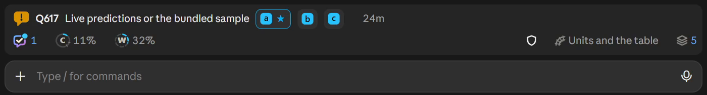

From the top, a band can hold:

| Row | What it says | What a press does |
|-|-|-|
| A question | One open question this session asked: the mark (amber when it blocks work, blue when it does not), its id in bold, its name, one chip per option with the recommended one starred, and its age. | A chip opens the card's strip under the row: the chip lit, the note field, **Answer now**, **Queue answer** and **Cancel** (**Unqueue** when the question is queued). **Answer now** records the answer; no model turn starts, and the row goes. With **Answer presses** at `once` ([Settings](settings-and-rules.md)), the chip records at once. |
| The count line | With two or more of this session's questions open, one line instead: `3 open`, and `1 blocking` in amber when any block. | Opens the pane on Questions. |
| This PC's health | When something in AskerDo on this PC is wrong (the local server down, the board join lost, a copy an update replaced), its first problem with the fix, as `askerdo status` reports it. | **Start**, **Restart** or **Run** runs the fix here; **Copy** copies a command to run on another PC. A fix only you can make, such as starting a new session, has no press. |
| A board call | Something only you can close: a look ("its work landed, and it closes at your look" with **Close** and **Not yet**), a judgment call (**Close it**, **Park it**, **Keep**), or an override request (**Allow**, **Keep**). Several override requests fold into one line. | Records your call on the board at once. |
| Review due | A track whose finished code tasks wait for a review, once they reach the review size ([Review coverage](concepts.md#review-coverage)). | **Open the track** opens the Tracks tab at that track. |
| Answers waiting | `1 answer waiting` (or `2 updates waiting`): answers and board news this session has not heard yet, with a **submit 1** chip (the count of what waits). | **submit 1** starts one turn carrying them. Nothing starts a turn by itself; a prompt you type also carries them. |
| Answers queued | `2 answers queued` in amber, with **Send**: answers you queued on a card or the band, kept on this PC and off the board ([Queued answers](#queued-answers)). | **Send** records them all and delivers them together. |
| Board offline | `board offline: drawn from this PC's last copy`, when the board cannot be reached. | None. See [Troubleshooting](troubleshooting.md#the-board-is-offline). |

Each row comes and goes on its own, so the band usually holds one or two of them over the status line. A look call on a task whose work landed:

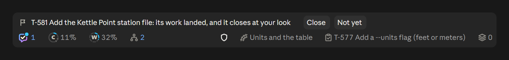

An answer you gave on the board, waiting for the session that asked, with the chip that starts a turn carrying it:

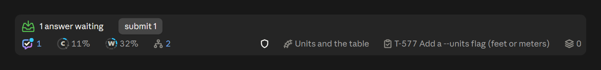

Hover a row or a chip for a card that says what it is and what pressing it does. A question's row gives the whole ask, the fact that decides it, and whether it blocks; a chip gives its option, what happens, the catch, and the token a press records:

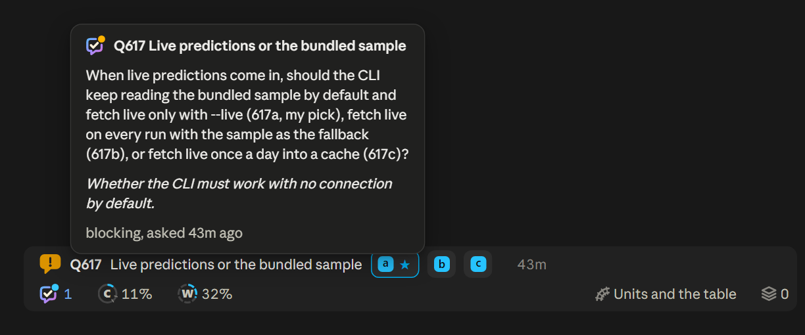

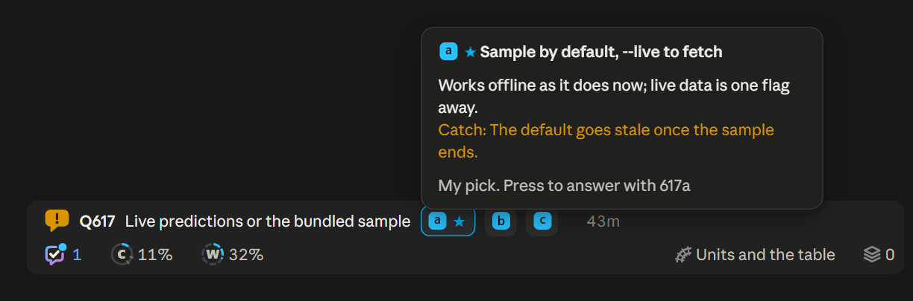

With several questions, the band shows the count line instead of a row per question. With nothing waiting, only the status line is left:

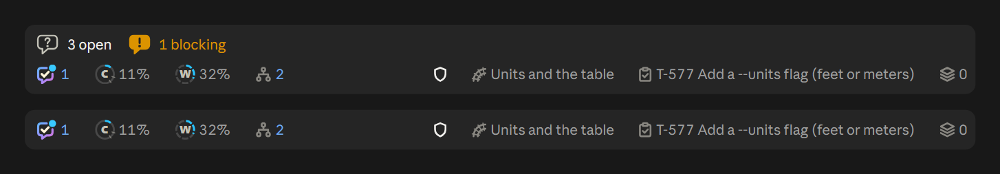

## The status line

The status line is the band's last row. The left group is about this session's context and your account; the right group is about the work this session holds. As the row narrows, words drop first (the task name, then the track name, then the labels), so the pictures stay.

| Part | What it shows | Press |
|-|-|-|
| The mark | The AskerDo mark. Plain when nothing waits outside this session; blue with a count when questions from other tracks wait on you; amber when one of them blocks. | Opens the pane on Questions when something waits, else on Home. |
| **C** ring | How full this session's context is. Sky blue below the handoff window (30 percent by default), amber from there to the wrap line (40 percent), red past the wrap line or at 450k tokens. Ticks mark the two lines. | None. |
| **5** ring | Your five-hour usage limit: amber from 85 percent, red at 100. Hidden on accounts without a five-hour limit. | Opens your usage page on claude.ai. |
| **W** ring | Your weekly limit, same colours. Blank and grey until the session's first reply reads it. | Opens your usage page on claude.ai. |
| Agents | The number of agents this session has running. Hover for a card per agent: its job, model, time, tool calls, current tool, and how deep its context is against the guard's 450k limit. | Opens Home with Agents unfolded. |
| Shield | The agent depth guard: green when on, an outline when off, amber when a guard notice is unread. | Turns the guard on or off for this project, the same as `/askerdo guard`. |
| Track | The track this session holds, with a chain icon when it is a side track. | Opens the track's page on the board. |
| Task | The newest task this session has in hand, with `+2` when it holds more. | Opens the task's page on the board. |
| Shelf | How many tracks wait on the shelf for a session; a grey `0` when none. | Opens the pane on Tracks. |
| Health | Only while AskerDo on this PC needs a fix: an amber monitor naming what is wrong (`local server`, `board join`, `tray`). Hover for the problem and its fix. | Runs the fix, as the band's health row does. |

Hover a part of the status line for its card. The C ring's card gives how much of the context is used and where the handoff window, the wrap line and the hard limit sit; the W ring's gives the weekly window and when it resets:

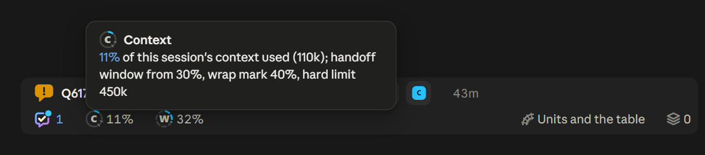

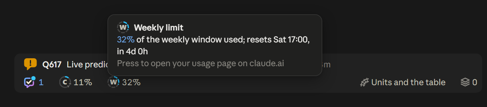

The C ring is the depth meter. [Concepts](concepts.md#the-depth-meter) says what the two lines mean, and [Settings and rules](settings-and-rules.md) how to move them.

## The AskerDo pane

The pane opens beside the conversation. Open it from the band (the mark, the count line, the shelf count) or with `/askerdo home`, `/askerdo questions`, `/askerdo pane` or `/askerdo guide`. Its head names the project folder and the git branch; five tabs sit under it, **Home**, **Questions**, **Tracks**, **Settings** and **Guide**, with a **board** link on the right of each.

### Home

- **The band's copy** at the top: the same rows and status line, at the pane's width.
- **Agents**, while any run. Shut, it is one line: the deepest agent's depth meter, how many run and the longest running time; press the ring to unfold a row per agent with its depth meter, job, model, running time, tool calls, current tool and depth.
- **Where we stand**: the held track drawn as a station map of its tasks, running ones lit, ready ones ringed, waiting ones joined by the edges they wait on. Finished code no review has read sits between the stations as amber beads, and a review still to do is a diamond, amber once reopened; a finished review leaves the map like any finished station, and its track's board page lists what it covered ([Review coverage](concepts.md#review-coverage)). **My track's lines** draws your track; **Whole workstream** draws every track in it. Every name on the map opens its board page, and the legend under it names the marks.
- **Activity**: the board's changes in this project, newest first, grouped by day. The filter takes words, a kind (`task`, `question`) or an id, and widening it reaches every project.
- **Versions** at the foot: this PC's AskerDo version and the board's, under the line **How it all works: the Guide tab**, which opens the Guide tab. When the board runs an older one, a line at the top of Home says so.

The version also shows in the mark's hover card, the tray's right-click menu and tooltip, the board's web pages, and `askerdo --version`.

### Questions

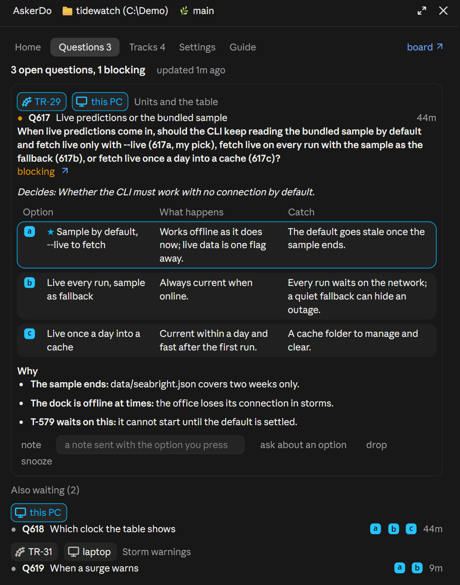

The header counts the open questions. One is pinned as a full card (below): the one you pressed open, else one from the track this session holds or from this session itself, blocking ones first. **Also waiting** lists the rest grouped by track and PC, with chips naming each; "this PC" and the track this session holds are drawn in sky blue so your own stand out. Each row has its option badges and age: press a badge to answer, or the name to pin its card.

### Tracks

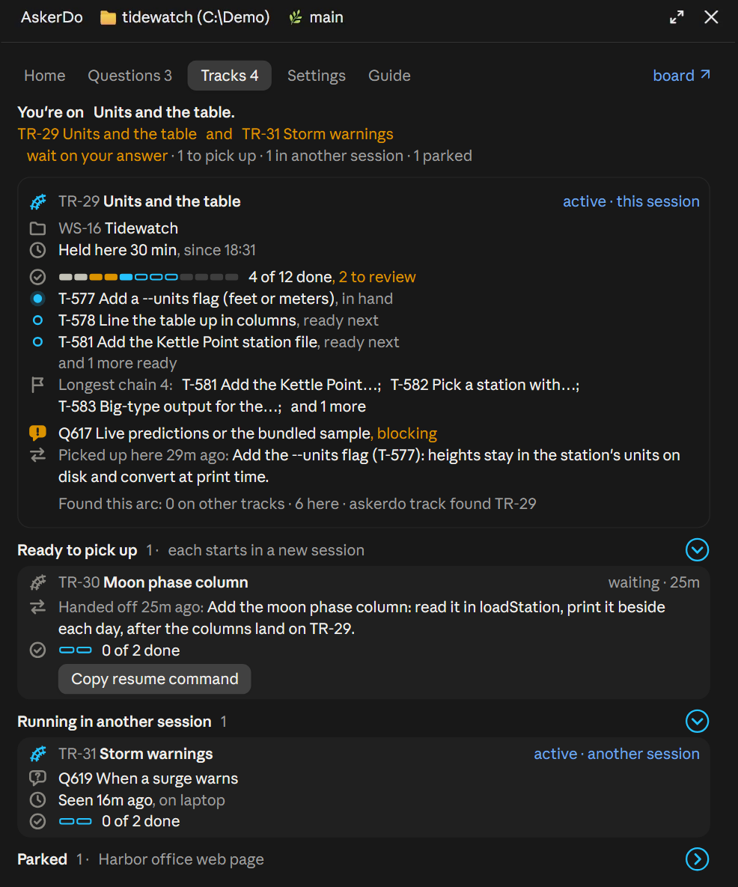

- **The bottom line** says where this session is, which tracks wait on your answer, and the counts: how many tracks to pick up, how many running elsewhere, how many parked.
- **The held track's card**: its workstream, how long it has been held, its progress, what runs now (and which agent runs it), what is ready next, its longest chain, the questions and handoff lines it waits on you for, and its last handoff. In the progress bar, finished work no review has read shows amber with "N to review" beside the count, a finish waiting for a review shows a padlock, and the card's state reads **review due** when one is due.
- **Found this arc**, on a track's card when its arc filed work: how many tasks it left unplaced (in amber, with their ids), how many went on other tracks and how many here, and the `askerdo track found TR-n` command that lists them with where each went.
- **Ready to pick up**: tracks no session holds, each with its handoff's focus and age. Press **Resume** to take one here, or **Copy resume command** when this session already holds a track: each track starts in a new session.
- **Running in other sessions**: tracks held elsewhere, with their open questions, the PC and when that session was last seen.
- **Parked**: folded, naming the tracks inside; press the ring to unfold them and their reasons.

Every track, task, question and decision name on the tab opens its board page: a card's head, its workstream, its longest chain, what it waits on, and the names in the bottom line and a folded section.

### Settings

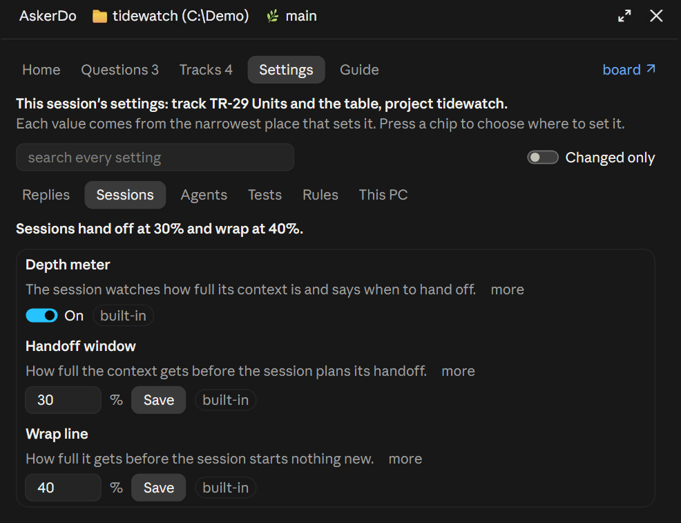

The first line names the record this session's settings come from (its track, else its project). Search across every setting, or turn on **Changed only**. The sub-tabs are **Replies**, **Sessions**, **Agents**, **Tests**, **Rules** and **This PC**, each with a count of changed values. Every row has a label, one line on what it does, **more** for the full help, its control, and a chip naming where the value is set; press the chip to set it somewhere else. [Settings and rules](settings-and-rules.md) covers every setting and the layers.

### Guide

The Guide tab lists the README and the guide pages of the AskerDo install the session runs, this one among them, in the order the README links them.

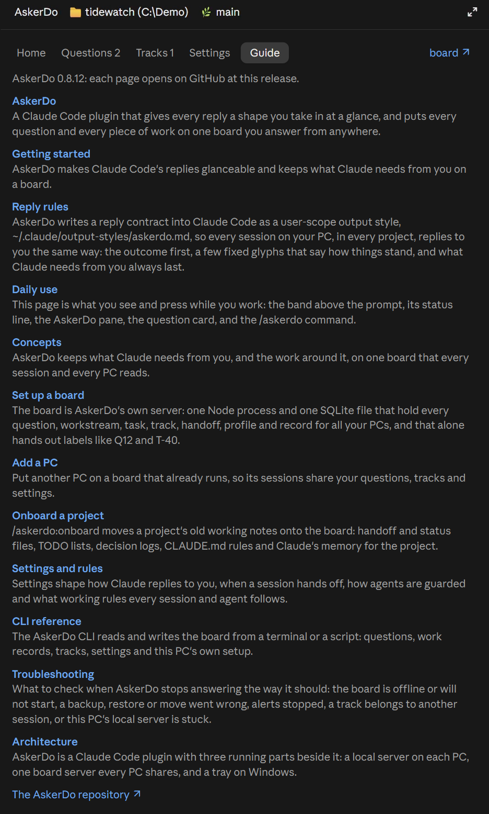

- **The top line** names the version the links point at.
- **A row per page**: its title, then its first line. Press the title to open the page on GitHub at the release you run.
- **The AskerDo repository** at the foot opens the repository itself.

## The question card

When a reply asks you something, the card for that question appears right under the reply, and the same card is pinned in the pane. The reply's Needs you footer draws under the last card, so it stays the last thing in the reply, with one line naming the questions on the cards above. Here Q619 waits under the reply that asked it, with the band below:

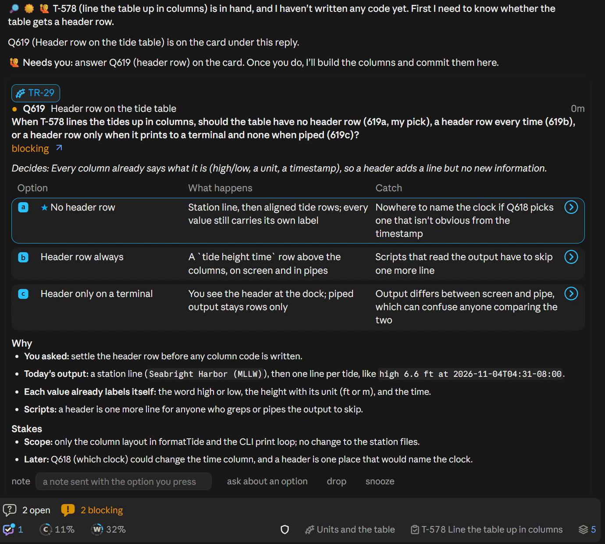

From the top:

- **The head**: a chip for its track (and its PC, when the card names one), the mark (amber when blocking), the id and name with the question's age, the question itself, and a meta line: blocking or not, with a link to its board page.
- **Decides**: the one fact that settles it, when the question has one.
- **The options**, one tile each: the letter, the option, what happens, and the catch. The recommended one is starred and framed. A ring on a tile unfolds why to pick it, why not, and how hard it is to undo.
- **Why** and **Stakes**: the short facts behind the question.
- **The foot**: a **note** field, **ask about an option**, **drop** and **snooze**. While an option's strip is open, the note field sits in the strip.

Pressing an option tile opens a strip right under it, the option lit: the note field, **Answer now**, **Queue answer** and **Cancel**. Pressing another option moves the strip there. With the **Answer presses** setting at `once` ([Settings and rules](settings-and-rules.md#this-pc)), a tile press records at once and no strip opens.

Once answered, the card turns green and reads `Answered 106a`.

| Press | What happens |
|-|-|
| An option tile (the starred one is the recommendation) | Opens the strip under it. |
| **Answer now** | Records that option at once, with the note when you wrote one, and the session that asked hears it. |
| **Queue answer** | Keeps that option and the note on this PC, off the board, until you press **Send**. The card reads `Queued 106a` and marks the option **queued**. |
| **Unqueue** | On a queued card's strip: drops the queued answer. |
| **Cancel** | Closes the strip; nothing is recorded. |
| **Send** | In every open strip while anything is queued, beside `N answers queued`: records and delivers every queued answer ([Queued answers](#queued-answers)). |
| **ask about an option**, then an option | Sends "Tell me more about 106a before I pick." to the session, which answers in a reply. |
| **drop** | Drops the question; the words in the note field are the reason. |
| **snooze** | Puts it to sleep: the note field takes a day (`2026-11-09`) or the words that wake it. A question still kept on this PC (an `L1` one, below) has no snooze. |

### Queued answers

Queue answers when you want a session to read several of them together instead of acting on each as it lands. A queued answer stays off the board, so nothing hears it yet; it is saved in this PC's AskerDo data folder, so a restart keeps it, and pressing another option on the card and **Queue answer** again changes it.

**Send**, on the band and in every open strip, records each queued answer on the board with its note, as **Answer now** would, then delivers them together: the ones this session asked arrive as one prompt, one turn carrying them all, and an answer to another session's question goes to that session, which reads it at its next turn. One toast says what was sent. A queued answer whose question was answered, dropped or reworded elsewhere since is not recorded: it leaves the queue with a line saying so. One that fails to record (the board not answering, say) stays queued, and the toast names it.

The band's chips share the queue: an answer queued from the band shows queued on its card and in the pane, and one queued on a card shows on the band's chip (an amber badge). A chip pressed on the band opens the same strip under the question's row:

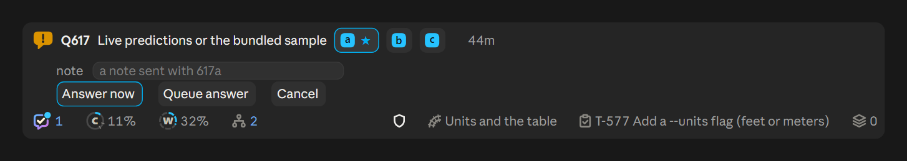

## Answering

Every answer is a question number and an option letter: `106b` answers question 106 with option b. You can answer from wherever you are:

| Where | How | A model turn? |
|-|-|-|
| The band | Press a chip, then **Answer now** or **Queue answer** (at `once`, the chip records). | No. |
| The card or the pane | Press an option tile, then **Answer now**; or queue several and press **Send**. | No. |
| The command | `/askerdo 106b` or `/askerdo 106b a note for the session`. | No. |
| The chat | Type `106b` in your message; the session records it. | Yes, it rides your prompt. |

Several answers go in one line: each token is its own answer, and the words after a token, up to the next one, are its note. `/askerdo 106b 107a` answers both, and so does `106b 107a` typed in chat. A token takes any of the forms the first does (`106b`, `106 b`, `Q106b`, `Q106 b`, `L1a`), and `and`, `&`, `plus`, `then` or a comma between two tokens joins them without becoming a note: `/askerdo 106b keep it small, 107a` gives 106b the note "keep it small".

The board's page for a question (`/askerdo board` links the project's) shows its options with the recommended one marked and, once given, the answer, but takes none: every answer goes through one of the rows above.

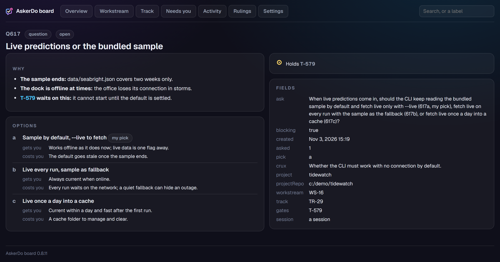

A session that has not started using the board yet keeps its questions under local labels, `L1`, `L2`, and you answer them the same way: `L1a`. Once it uses the board, they are filed there with board numbers.

## The `/askerdo` command

Type `/askerdo` in the prompt; the typeahead lists every subcommand with one line each. Every subcommand works on a board. In text mode, the fallback for a PC with no board, `/askerdo pane` opens the pane, whose Settings and Guide tabs work, `/askerdo guide` opens it on Guide and `/askerdo help` lists the subcommands; the bare `/askerdo` and the other subcommands read or write the board and need one. The [Command alias](settings-and-rules.md) setting adds a second name for it, taking effect in your next session.

| Command | What it does | Example |
|-|-|-|
| `/askerdo` | Lists the open questions for this project. | `/askerdo` |
| `/askerdo <n><letter> [note]` | Answers a question, with an optional note; several tokens in one line are several answers. | `/askerdo 106b keep it under 1 GB`, `/askerdo 106b 107a` |
| `/askerdo home` | Opens the pane on Home. | `/askerdo home` |
| `/askerdo questions` | Opens the pane on Questions. | `/askerdo questions` |
| `/askerdo pane` | Opens the pane on Tracks. | `/askerdo pane` |
| `/askerdo guide` | Opens the pane on Guide. | `/askerdo guide` |
| `/askerdo board` | Gives the link to this project's board page. | `/askerdo board` |
| `/askerdo track` | Shows the track this session holds. | `/askerdo track` |
| `/askerdo track TR-n` | Shows a track without taking it. | `/askerdo track TR-29` |
| `/askerdo track new WS-n <name>` | Starts a track in a workstream. | `/askerdo track new WS-16 More stations` |
| `/askerdo track park [TR-n] "reason"` | Parks a track at once, with no handoff. | `/askerdo track park TR-9 "waits on the tile format"` |
| `/askerdo track finish [TR-n] ["outcome"]` | Closes a track as done. | `/askerdo track finish "cache capped at 500 MB"` |
| `/askerdo track splinter [T-n] <name>` | Starts a side track from this one and moves this session onto it. | `/askerdo track splinter T-44 Slow disk tests` |
| `/askerdo track capture [inbox] <idea>` | Adds a task to the held track, or to the workstream's inbox. | `/askerdo track capture inbox Cache size in settings` |
| `/askerdo track pane` | Opens the pane on Tracks. | `/askerdo track pane` |
| `/askerdo park "reason"` | Asks the session to write a parked handoff of its track. | `/askerdo park "waits on the design review"` |
| `/askerdo handoff` | Asks the session to write its handoff now. | `/askerdo handoff` |
| `/askerdo resume` | Lists the shelf. | `/askerdo resume` |
| `/askerdo resume TR-n [words]` | Takes a track in this session; your words go with the kickoff. | `/askerdo resume TR-29 start with the meters test` |
| `/askerdo resume WS-n` | Takes the one track waiting in that workstream. | `/askerdo resume WS-16` |
| `/askerdo resume TR-n --take-over` | Takes a track another session holds; that session is told. Also `--read-only` (the kickoff without taking it) and `--splinter <name>`. | `/askerdo resume TR-10 --read-only` |
| `/askerdo guard [on \| off]` | Shows or sets the agent depth guard for this project. | `/askerdo guard off` |
| `/askerdo proc <words>` | Finds a procedure by its trigger words. | `/askerdo proc release` |
| `/askerdo proc ran <name> clean` | Records a clean run of a procedure. | `/askerdo proc ran release clean` |
| `/askerdo proc ran <name> deviated "note"` | Records a run that left the steps, and how. | `/askerdo proc ran release deviated "skipped the tray rebuild"` |
| `/askerdo proc scan` | Reads the project's procedure files again and updates their cards. | `/askerdo proc scan` |
| `/askerdo allow K-n` | Your Allow on an override request for that record. | `/askerdo allow K-12` |
| `/askerdo keep K-n` | Your Keep: the record stays as written. | `/askerdo keep K-12` |
| `/askerdo unscrub K-n` | Puts back text a scrub removed, within 7 days. | `/askerdo unscrub K-12` |
| `/askerdo help` | Lists every subcommand with a line each, and names the Guide tab. | `/askerdo help` |

Most `/askerdo` commands answer in the mod and start no model turn. `park` and `handoff` ask the session to write the handoff, and `resume` of a track hands its kickoff to the session as one turn. The [CLI reference](cli.md) has the verbs these commands call.

## In the terminal

Claude Code in a terminal shows the same band and status line, drawn in text:

- **Band rows** start with a glyph: `●` a question, `✓` answers waiting, `◆` a board call, `❓` the count line. Chips are buttons with the letter on sky blue.
- **The status line** sits under the prompt, beside Claude Code's own hint: `◔ C 32%`, `H` and `W` for the usage limits, `🛡 on` for the guard, `⁂` for agents, `▤` for the shelf, `!` and what is wrong while this PC needs a fix, and the word `AskerDo` at the end, which opens the pane.
- Hover cards are one plain line; rings show no empty state and the shelf no grey `0`. Folds use `▸` and `▾`.

Answering and `/askerdo` work the same way. The terminal look is measured less than the desktop's, so expect small differences.

## Related

- [Concepts](concepts.md): what questions, tracks, handoffs and profiles are for.
- [Settings and rules](settings-and-rules.md): every setting and rule line, and where each is set.
- [Getting started](getting-started.md): install, configure, and your first question.
- [CLI reference](cli.md): the commands under the band and the pane.
- [Troubleshooting](troubleshooting.md): the board offline, a track another session holds.
