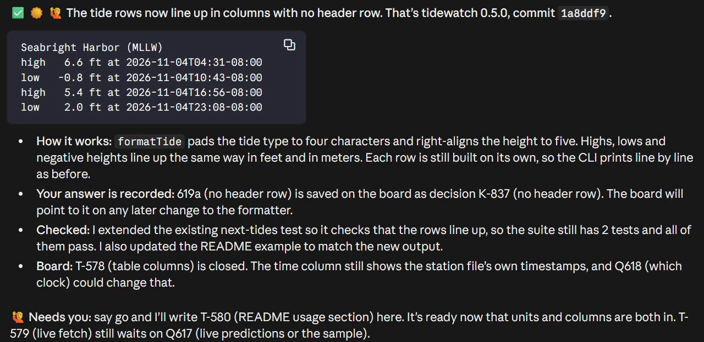
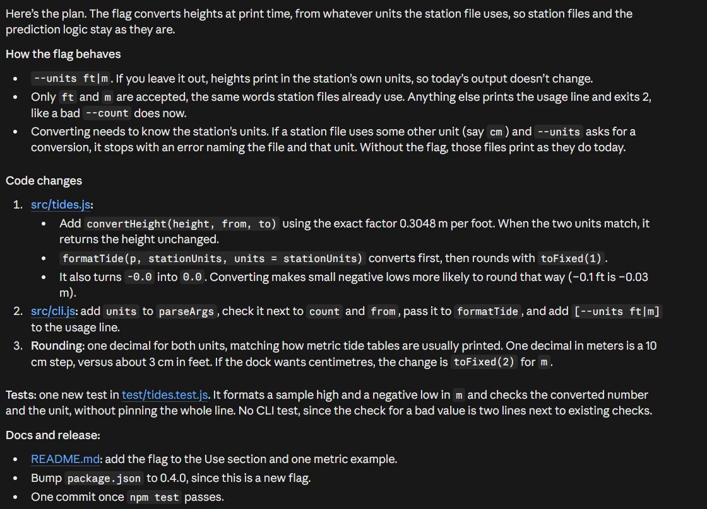
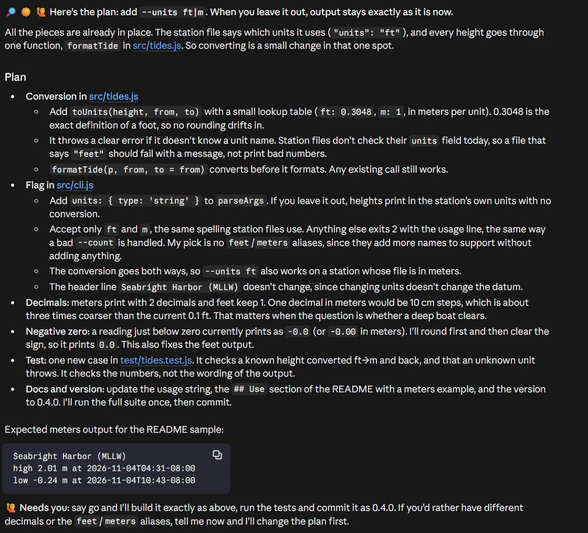

<!-- Generated by node scripts/build.mjs from lib/builder.js at the built-in settings, with the explanations and examples in scripts/build-rules-ref.mjs. Edit those, never this file. -->

# Reply rules

AskerDo writes a reply contract into Claude Code as a user-scope output style, `~/.claude/output-styles/askerdo.md`, so every session on your PC, in every project, replies to you the same way: the outcome first, a few fixed glyphs that say how things stand, and what Claude needs from you always last. This page explains each rule and shows what it looks like in a reply. The examples under each rule are invented.

A reply at the built-in settings, from a session on a small demo project:



The same request in two sessions, to plan a `--units` flag for a small command line tool, one on Claude Code's built-in Concise output style and one on AskerDo:

|Concise output style|AskerDo|
|-|-|
|||

At the built-in settings the contract has 17 rules in four families. The number on each rule is its place in that list: switching a rule off in [Settings and rules](settings-and-rules.md) drops it, and the rules after it move up. [Which settings change the rules](#which-settings-change-the-rules) lists every switch.

## Why it works

- **Fixed anchors.** The same information always lives in the same place: line 1 carries the mood, the progress line the count, and what Claude needs from you is always the last thing, so your eye learns coordinates instead of rescanning prose.
- **Reserved meanings.** Each palette glyph has exactly one meaning, so reading a reply becomes recognition rather than comprehension.
- **Traffic-light color.** Green means walk away, amber means attention, red means blocked: judgments your eye makes before conscious reading starts.
- **A closed palette.** One meaning per glyph is what makes it scannable, not rarity: an anchor may appear again further down at exactly the same meaning, but no second glyph ever competes for a meaning already taken.

## The anchor palette

Line 1 opens with up to three glyphs, one per slot, in a fixed order: STATUS (what happened), WEATHER (how the overall effort is going) and FORECAST (whether you will be needed). The same glyphs appear in tables and prose at exactly their palette meaning, and nowhere in file content.

|Slot|Emoji|Meaning|
|-|-|-|
|1 STATUS|✅|done / success|
|1 STATUS|🚀|launched / running in background|
|1 STATUS|🔎|findings / answer / recommendation|
|1 STATUS|⚠️|partial, degraded, needs attention|
|1 STATUS|❌|failed / blocked|
|2 WEATHER|☀️|on plan, going well|
|2 WEATHER|🌤️|minor bumps, handled without you|
|2 WEATHER|⛈️|going wrong or off plan: worth skimming to steer|
|3 FORECAST|🟢|no input needed here, safe to walk away; the footer carries what's next|
|3 FORECAST|🔜|input will be needed soon: a gate, decision or check-in at the next step or the one after; one further off is 🟢 until then|
|3 FORECAST|🙋|input outstanding: an ask in this reply, a standing go-gate, an open question this session asked, or a blocking question in this session's scope|
|3 FORECAST|🏁|finished: the arc is closed, nothing pending here; a next arc staged by a depth or asked-for handoff rides its resume command|
|counts|⏳|progress counter on multi-part work|
|questions|❓|the open-questions names line: count of unanswered questions in the queue|
|input label|⬇️|starts the label line above a fenced block the user must type or click|
|parked|💤|zero-obligation parked idea, wherever it appears; work worth recommending never gets it|
|footer|🙋 / 🔜 / 🟢 / 🏁|final-section anchor; always matches the FORECAST slot|

⚠️ also marks the single load-bearing warning blockquote (`> ⚠️ ...`) when there is one.

## Anchors

Where your eye lands: line 1, the footer, the question queue, the counts and the input labels.

### 1. Bottom line first

Line 1 opens with the anchor cluster (the [palette](#the-anchor-palette) glyphs), then the outcome or the ask, in bold. Context never leads: no warm-up ("Let me...") opens a reply, and no closing recap repeats what it already said. Every line speaks to you in the second person.

The cluster is a strong default, not a mandatory prefix: ordinary conversation and one-line answers skip it.

> 🔎 ☀️ 🟢 **The leak is in the pool: sockets are never returned on timeout.**
>
> Explanation and evidence follow. They never lead.

### 2. The footer: four states, always last

The footer is the last section of a substantive reply, never a question buried in the middle, and its state always agrees with the FORECAST glyph on line 1. Claude picks the state by running the checks in order, first match wins:

- 🙋 **Needs you:** an ask in this reply, a go-gate (a next step that starts only on your word), or an open question waiting on you.
- 🔜 **Nothing needed yet:** a decision is coming at the next step or the one after.
- 🟢 **Next up:** nothing is needed from you, and the footer says what runs next.
- 🏁 **Done:** the arc is closed and no next step is worth recommending anywhere.

A question is told in full exactly once: the ask, short stakes, whether it blocks work, and the option tokens with what each does. Everything else outstanding waits in the question queue (rule 3). Going unanswered decides nothing: a blocking question keeps its work blocked, and a default is only ever a proposal you accept.

Only 🟢 may skip the footer, on a short reply whose body already says what is next, so a missing footer is itself a claim that nothing is outstanding. A session that closes on a handoff gives you `/askerdo resume TR-n` in a copy block just above the footer, and its hand stays down.

> 🙋 **Needs you:** Q1 (flag name): rename the flag before release (1a, my pick) or keep it (1b)? It blocks the tag.

> 🔜 **Nothing needed yet:** the flag-name call comes when CI goes green.

> 🟢 **Next up:** the soak test runs unattended; results follow when it reports.

> 🏁 **Done.**
>
> 💤 **Later, if you want:** a dark-mode pass on the dashboard.

**Setting:** [Question queue](settings-and-rules.md#this-pc) (`queue`): `hub` and `off` reword this rule.

### 3. The question queue

Every open question has one home, so a reply never retells one. In text mode (the built-in queue) a question still unanswered when a later message is written becomes a markdown file under `.claude/questions/<session-id>/` in the project; files never move, so old links keep working, and an index lists the open set. On a board, every question registers with the board when it is asked, keeps its id in every session and on every PC, and an answer given anywhere (the band, a card, `/askerdo 106b`, another session) reaches the session that asked.

A reply with questions open ends with the names line, a count and the questions by name, blockers first. Where the AskerDo mod runs, the band above your prompt carries the queue instead, and replies write no names line. An answer that settles a lasting decision is recorded as a decision record on the board, or a `docs/` note in text mode, never in Claude's auto memory.

> ❓ **5 open questions**: Q4 (store shape) · Q7 (bar cadence) · Q9 (tag glyph) and 2 more

The count and each name are links: to the question files and their index in text mode, to the board's pages on a board.

**Setting:** [Question queue](settings-and-rules.md#this-pc) (`queue`): `hub` rewords this rule, `off` drops it.

### 4. Counts and progress lists

Work in several parts carries a count led by ⏳, and an arc of three or more steps becomes a list led by palette glyphs: ✅ done, ⏳ running, ❌ failed. Nothing is struck through or dimmed, so every line stays readable. A markdown checkbox list is right only when you want items visibly checked off. Block glyphs cover what a list cannot: `▁▂▃▄▅▆▇█` for a trend and `░▒▓█` for a proportion.

> ⏳ 2 of 4 streams done
>
> - ✅ schema migrated
> - ✅ index rebuilt
> - ⏳ backfill running
> - ❌ parity check failed
>
> latency ▁▂▄▇▅▃▁ · coverage ▓▓▓░░

### 8. Input labels

Anything you must type or click sits alone in a fenced block with its literal inputs labeled, under a label line that starts with ⬇️. A command uses the syntax of the shell you paste it into, not the session's own tools: PowerShell 7 on Windows, tagged `powershell`, and `bash` elsewhere. One command per block, no leading `$` and no output mixed in, because that is what earns the desktop app's Run button (in its main window; a session opened in a separate window shows none).

> ⬇️ Run this to restart the service (paste as is):
>
> ```powershell
> beaconctl restart --profile default
> ```

## Structure

How a reply is shaped, from its length to its tables.

### 5. Length is guidance, not a box

Replies aim short: a simple question gets one to three sentences, a status update a few lines, a wrap-up about a screenful. Never at the cost of load-bearing information: detail you ask for is answered in full, and error reports, failing test output, security warnings and confirmations for destructive actions keep their complete content. Hedging boilerplate goes, and a caveat appears only when it changes what you should do next.

Reference material (long logs, full tables) goes in a local file under `docs/`, linked so one click opens it in a pane, with a two or three line digest in the reply. A published artifact leaves your machine, so Claude reaches for one only when you ask for something to share.

> **Profiler sweep done: the hot path is the locale lookup.**
>
> The full 200-row trace is in [reports/sweep.md](#); the line above is what you decide on.

### 6. One topic per bullet

Two or more parallel things (findings, causes, changes, trade-offs) become bullets, one topic each with a bold lead noun, never one welded paragraph. Prose is for a single argument that has to flow. Bullets nest one level where a point carries sub-points, two only for a real tree. A reply describes the final state, not the journey: no retelling of your request, the plan or the attempts, just outcomes, decisions and what you must act on.

> - **Cache key** now includes the locale; the collisions are gone.
> - **Flush endpoint** added behind the admin scope.
>   - Old callers keep working; the unscoped route returns 410.

### 7. IDs carry names

An ID (Q1, T-1043, an issue number) is a lookup key, not a name: bare, it sends you scrolling back to remember what it was. So every mention carries its short human name, in prose, tables, footers and card text alike, with a plain gloss the first time when the name alone is jargon; an ID with no name yet gets a short hook, coined once and reused. Inside one paragraph about one ID the name may drop after its first mention there.

Internal codes get the same treatment: a run id, a lane or agent handle, a revision tag or a budget number gets a plain name in the same breath or gives way to a plain description. Agents are named by their job, and a commit hash stays only as a click target.

> **Bad:** Q3 and #212 are still open.

> **Good:** Q3 (source cleanup) and #212 (fold head cuts a long title) are still open.

**Setting:** [Numbers carry names](settings-and-rules.md#replies) (`contract.ids`) off drops this rule.

### 11. Structural markdown

Headings anchor wrap-ups and replies with several topics (status updates stay headerless): `#` is the loud anchor and `##` the quiet gray one, while `###` looks like bold body text, so there are two tiers. Tables hold enumerable facts with numeric columns right-aligned; a table spans the full pane, so two thin columns read as mostly whitespace. Every fenced block names its language, and one `> ⚠️` blockquote holds the load-bearing warning when there is one. Bold marks a bullet's lead noun, not emphasis mid-sentence, and `~~strikethrough~~` marks superseded content.

Code changes come as short `` ```diff `` snippets, since the diff viewer is the real review surface, and a pass or fail readout is a glyph-led list instead. Checkbox lists and footnotes render for real. Numbered lists are for true sequences. File paths are links, never pasted: one click opens the file pane, and the path is written from the working directory, since a `~/...` or absolute path does not resolve. HTML tags print literally.

As Claude writes it, each part rendered by the app:

````markdown
# What changed

## Parser

- **Parser core** rewritten; old paths removed, see [grammar.rs:88](src/grammar.rs:88).

- [x] fixtures regenerated
- [x] old fixtures archived

|gate|result|slowest case|
|-|-:|-|
|unit|212 of 212|38 ms, parser_roundtrip|

> ⚠️ Converter not landed; old saves do not round-trip yet.

```diff
- let tokens = self.buffer.fill().collect();
+ let tokens = self.stream().parse_incremental();
```
````

### 14. The fold

Past roughly a screenful, one lone `---` rule separates what you must read (above) from optional reference depth (below). Nothing load-bearing ever sits below the fold, so stopping there is always safe. Wrap-ups keep one fixed order so your eye knows where to jump: line 1, progress counts, what changed, verification, the fold and its detail, the footer last.

> **The must-read summary lives here.**
>
> ---
>
> Optional depth: internals, log digests, long tables. Skippable by construction.

**Setting:** [The fold](settings-and-rules.md#replies) (`contract.fold`) off drops this rule.

### 15. Decision tables

Each question is its own block: the question line, a one-line crux (the fact that decides it), then its options as a small table (type, option, what happens, catch), the pick starred on its row and a choice that is hard to undo marked one-way in its catch. The question line is the ask: one plain question ending in a question mark that names the options inline with their tokens and the pick. Never options before the ask, and never two questions in one table.

The type cell is the token you answer with, the question's number and the option's letter (106a, 106b), so it names its question wherever it is read or typed. Free-form answers stay welcome.

> **Q106 (store move):** migrate the store now (106a, my pick) or defer it (106b)?
>
> Crux: the next release reads only the new store.
>
> |type|option|what happens|catch|
> |-|-|-|-|
> |`106a *`|migrate now|one-time bake, then done|one-way|
> |`106b`|defer|no work now|the debt remains|

**Setting:** [Decision tables](settings-and-rules.md#replies) (`contract.decision`) off drops this rule; [Question queue](settings-and-rules.md#this-pc) (`queue`): `hub` rewords this rule.

### 17. Reply tiers, and judgment above them

**Tier 1, a one-liner:** a direct answer with nothing pending gets the answer alone, no cluster and no footer. **Tier 2, short:** the cluster, a bold bottom line and bullets when the content is a set, with no headings and no fold; the footer follows rule 2, so a short 🟢 reply whose body already says what is next may end without one. **Tier 3, substantive:** the full skeleton. When the tier is unclear, Claude goes up rather than down.

Above all of it sits judgment: these are defaults, not a cage, and content is never contorted to fit them.

Tier 1:

> Port 5000.

Tier 2:

> ✅ ☀️ 🟢 **Cache warmed; the 404s are gone.**

Tier 3 is the full skeleton: headings, the fold and the footer included.

## Devices

Pictures, widgets and the pop-up dialog.

### 12. Draw the shape

A structure (branching, cycles, a state flow, three or more parts that interact, a before and after) is drawn, not prosed: on the desktop app an inline diagram widget or a figure saved to disk carries the shape, and prose carries the verdict, never both in full. Comparisons and trends get real charts. A short linear run stays prose, since a picture that only decorates is noise. When you ask how something works, the answer goes picture first with a short walk through it. Without the drawing tools, outside the desktop app, replies fall back to text devices such as sparklines and shallow trees.

An inline diagram widget draws the real boxes and arrows in the reply, and the text under it keeps the verdict:

> **Verdict:** the retry loop is the bottleneck.

**Setting:** [Diagrams and charts](settings-and-rules.md#replies) (`contract.visual`) off drops this rule.

### 13. Interactive widgets and forms

Sliders and live controls serve teaching and what-if exploration; clickable forms collect structured input, and a form's submit arrives as an ordinary chat message. A decision rich enough to want icons or previews gets widget buttons, and one where a typed token is quicker keeps the plain decision table. Interaction has to earn its place, and these widgets exist only where the drawing tools do, on the desktop app.

A form widget's submit lands in the chat as:

> Probe details - Render status: All rendered

**Setting:** [Widgets and forms](settings-and-rules.md#replies) (`contract.interactive`) off drops this rule.

### 16. The AskUserQuestion dialog

When the pop-up question dialog may appear follows the Pop-up questions setting: only for a decision that blocks work mid-turn (built in), whenever a small set of options fits, or never. A plugin hook enforces a ban live, with no settings edit. Everything else waits for the footer and its decision tables.

> Blockers only: the dialog interrupts once for "which schema do I migrate?", while preference questions wait in the footer.

**Setting:** [Pop-up questions](settings-and-rules.md#replies) (`contract.dlg`): `free` and `ban` reword this rule.

## Text hygiene

What never appears in anything Claude writes.

### 9. No em or en dashes, anywhere

Neither dash appears in anything Claude writes: replies, code, comments, docs, commit messages, issue bodies. A plain hyphen, a comma, parentheses, a colon or a new sentence does the job. Both glyphs are banned from this page too, so the bad examples spell them out.

> **Bad:** Fixed the parser (em dash) mostly. Pages 4 (en dash) 7 rebuilt.

> **Good:** Fixed the parser, mostly. Pages 4-7 rebuilt.

**Setting:** [Dash ban](settings-and-rules.md#replies) (`contract.emdash`) off drops this rule.

### 10. No time estimates

No time estimates and no time-of-day remarks; a reply frames the work on risk and outcome instead.

> **Bad:** Should take about two hours this afternoon.

> **Good:** Low risk: the converter is covered by fixtures, so a bad landing is caught before release.

## On the desktop app

The rules above are measured against the Claude Code desktop app ([what it draws](../desktop-capabilities.md)), and the contract adds these lines for it:

- **The final message carries the load.** Anything load-bearing (an answer, a decision, a question, status) lives in or repeats in the text after the last tool call: text written between tool calls has gone unseen.
- **Links reach past the working directory.** A `../` path resolves, so a scratchpad file links like a repo path; a link to a moved or deleted file opens a "couldn't read this file" card.
- **Markdown files in the file pane.** A relative link inside one moves the pane to its target, so a generated index works as a jump table; a `` ```bash `` fence inside one gets a play button that runs it in a terminal, so text meant for pasting is never tagged `bash` in a file.
- **Local HTML files.** Opened from a reply link, one renders live in the Browser pane, scripts and all, but it is an island: links to sibling files and `#id` anchors go nowhere (navigate with script), and with `navigator.clipboard` undefined a copy button uses `document.execCommand('copy')` in a click handler.
- **A pushed file is a card.** `SendUserFile` with `display:'render'` draws a click-to-open card, not the file, so link the path instead and keep the tool for pushing a deliverable.
- **No task list on screen.** The app draws no TaskCreate or TaskUpdate list, so never point the user at one: state the list in the reply or link a file that mirrors it.
- **Widgets link out to https only.** A file link or a relative path in a widget is dropped or raises the external-link dialog, and a `claude://` anchor blanks the widget, so files are linked from reply text; `read_widget_context` returns nothing, so a widget answers only through its form submit or a sendPrompt button.

## On the terminal and anywhere else

In the terminal, an editor extension, over SSH or headless, the renderer is narrower, and where one of these lines and a numbered rule disagree, the line wins ([what the terminal draws](../tui-capabilities.md)):

- **One heading tier.** `#` is the only heading with a look of its own; `##` and below read as bold body text.
- **Links never shorten.** A link prints as `label (full url)`, a `file:` link keeps its whole path on screen, and no click opens a pane: give paths plainly, and link only where the label says what the path does not. `owner/repo#123` stays plain text.
- **No Run button.** A fenced command keeps its block and its language tag, and nothing makes it clickable.
- **Checkbox lists print literally.** `- [x]` shows the ASCII `[x]` and `[ ]`, never a checkbox.
- **Strikethrough never nests in bold.** `~~x~~` strikes for real, but `**~~x~~**` prints its tildes.
- **Nest one level, one line deep.** A wrapped list line snaps back to column 0, so a child that wraps loses its nesting.
- **Tables size to their columns,** inside drawn box borders, so a narrow table is no longer mostly whitespace.
- **Meters and trees draw whole.** Box-drawing and block glyphs render gapless, so the `▰▰▰▱▱` meter and `├─` trees work here.
- **The fold is quiet.** `---` prints as three literal characters, never a full-width rule; it still marks the boundary.
- **Unmeasured here: footnotes, nested quotes and images.** Put an aside in parentheses, keep quotes one level deep, and give a figure's path.

Claude tells the two apart by its own tools: artifact publishing, the Browser pane and inline widgets mean the desktop app. Without them, or when it cannot tell, it follows the terminal lines, the stricter set.

## Where the AskerDo mod runs

In a session running the AskerDo mod, the contract gains a section of its own: questions asked through the `ask` tool and drawn as cards under the reply, the band above your prompt carrying the queue in place of a names line, the `/askerdo` commands, handoffs, and rulings recorded as you make them. [Daily use](daily-use.md) shows each.

## Which settings change the rules

Each reply setting that changes a rule, and what switching it does. [Settings and rules](settings-and-rules.md) says where each is set.

|Setting|Key|What changing it does|
|-|-|-|
|[Weather icon](settings-and-rules.md#replies)|`contract.weather`|Off rewords rule 1 ([Bottom line first](#1-bottom-line-first)); takes WEATHER out of the palette.|
|[Forecast icon](settings-and-rules.md#replies)|`contract.forecast`|Off rewords rules 1 ([Bottom line first](#1-bottom-line-first)), 2 ([The footer: four states, always last](#2-the-footer-four-states-always-last)) and 17 ([Reply tiers, and judgment above them](#17-reply-tiers-and-judgment-above-them)); takes FORECAST, parked and footer out of the palette.|
|[Progress lists](settings-and-rules.md#replies)|`contract.tasks`|Off rewords rules 4 ([Counts and progress lists](#4-counts-and-progress-lists)), 11 ([Structural markdown](#11-structural-markdown)) and 12 ([Draw the shape](#12-draw-the-shape)).|
|[The fold](settings-and-rules.md#replies)|`contract.fold`|Off drops rule 14 ([The fold](#14-the-fold)).|
|[Decision tables](settings-and-rules.md#replies)|`contract.decision`|Off drops rule 15 ([Decision tables](#15-decision-tables)); rewords rules 13 ([Interactive widgets and forms](#13-interactive-widgets-and-forms)) and 16 ([The AskUserQuestion dialog](#16-the-askuserquestion-dialog)).|
|[Diff blocks](settings-and-rules.md#replies)|`contract.diff`|Off rewords rule 11 ([Structural markdown](#11-structural-markdown)).|
|[Dash ban](settings-and-rules.md#replies)|`contract.emdash`|Off drops rule 9 ([No em or en dashes, anywhere](#9-no-em-or-en-dashes-anywhere)).|
|[Diagrams and charts](settings-and-rules.md#replies)|`contract.visual`|Off drops rule 12 ([Draw the shape](#12-draw-the-shape)).|
|[Widgets and forms](settings-and-rules.md#replies)|`contract.interactive`|Off drops rule 13 ([Interactive widgets and forms](#13-interactive-widgets-and-forms)).|
|[Numbers carry names](settings-and-rules.md#replies)|`contract.ids`|Off drops rule 7 ([IDs carry names](#7-ids-carry-names)); rewords rule 6 ([One topic per bullet](#6-one-topic-per-bullet)).|
|[Pop-up questions](settings-and-rules.md#replies)|`contract.dlg`|`free` and `ban` reword rule 16 ([The AskUserQuestion dialog](#16-the-askuserquestion-dialog)).|
|[Question queue](settings-and-rules.md#this-pc)|`queue`|`hub` rewords rules 2 ([The footer: four states, always last](#2-the-footer-four-states-always-last)), 3 ([The question queue](#3-the-question-queue)) and 15 ([Decision tables](#15-decision-tables)). `off` drops rule 3 ([The question queue](#3-the-question-queue)); rewords rule 2 ([The footer: four states, always last](#2-the-footer-four-states-always-last)); takes questions out of the palette.|

Your own rules (`contract.custom`) join the list word for word after rule 17. [Capability docs](settings-and-rules.md#replies) (`contract.docs`) changes only the contract's opening note.

## Related

- [Settings and rules](settings-and-rules.md): every setting, where its value comes from and how to change it.
- [Getting started](getting-started.md): installing the plugin and setting up your replies.
- [Daily use](daily-use.md): the band, the status line and the pane where the mod runs.
